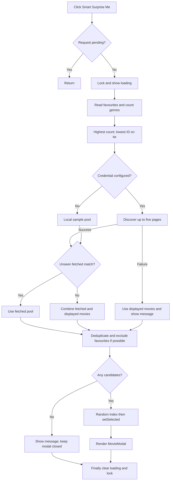

# Section 1 — Feature overview

Smart Surprise Me opens a randomly selected film in the existing movie details modal. It helps a viewer discover a film using the genres already present in their watchlist. The old button selected only from the currently displayed page. The new button asks TMDB for a larger pool, independently of the current search, sort and genre filters.

With zero favourites, there is no preferred genre: request popular discover results across all genres. With one favourite, count its genres and choose the lowest numeric genre ID when tied. With multiple favourites, count each genre once per movie and choose the most frequent; the lowest ID still wins ties. Genre IDs are identifiers, not quality scores. Missing genre arrays contribute no counts. If every favourite lacks genres, use the same broad discovery as zero favourites.

TMDB supplies up to five pages of results (normally up to 20 movies per page). Without an API credential, the existing local sample data is used instead. A movie already in favourites is excluded whenever an unseen candidate exists. If matching results contain no unseen film, broaden to the fetched pool plus the currently displayed movies. If all available films are favourites, allow a repeat. If nothing is available, show a message and do not open a modal.

# Section 2 — Files involved

| File location | Modified/New | Purpose |
|---|---|---|
| `src/pages/HomePage.tsx` | Modified | Button, loading, fallback messages and selected movie state |
| `src/services/movieService.ts` | Modified | Adds `fetchRecommendationPool`, reusing credential and request helpers |
| `src/utils/recommendation.ts` | New | Pure genre counting and candidate selection functions |
| `src/test/smart-surprise.test.tsx` | New | Rule, service and interface tests |
| `src/test/complete-spa.test.tsx` | Modified | Updates three old Surprise Me integration expectations |
| `docs/feature.md` | New | This learning guide (prose, no executable functions) |
| `src/types.ts` | Reused | `Movie`, `MovieResponse`, genre and filter interfaces |
| `src/context/AppContext.tsx` | Reused | Provider, reducer and favourite persistence |
| `src/context/appContextValue.ts` | Reused | Context value and `favorites: Movie[]` contract |
| `src/hooks/useAppContext.ts` | Reused | Reads the provider value |
| `src/utils/storage.ts` | Reused | Reads and writes full favourite objects and credentials |
| `src/hooks/useMovies.ts` | Reused | Current movie list and its loading/error states |
| `src/hooks/useGenres.ts` | Reused | Genre names for cards and modal |
| `src/components/MovieModal.tsx` | Reused | Displays selected film and existing watchlist controls |
| `src/hooks/useModal.ts` | Reused | Modal focus, keyboard and close behaviour |
| `src/index.css` | Reused | Existing `btn-icon-label`, `surprise-button`, and modal styling; no new CSS |
| `src/data/sampleMovies.ts` | Reused | Offline sample pool |
| `src/data/genres.ts` | Reused | Offline genre names |
| `src/test/setup.ts` | Reused | DOM matchers and automatic cleanup |

# Section 3 — Complete code explanation by file

The following snapshots reproduce all new production functions and the complete changed HomePage. Existing code in HomePage is identified in its explanation. The service adds only one method; the existing request helpers are also shown because they explain authentication and errors. Tests are reproduced completely. This Markdown file itself contains documentation rather than executable application code.

## File location: `src/utils/recommendation.ts`

**Purpose and function contracts:** New code. `getPreferredGenre(favorites: Movie[]): number | undefined` receives complete saved movie objects, returns the most frequent genre ID, and calls standard array/object methods only. HomePage calls it before fetching. No asynchronous work or expected exceptions occur. `pickRecommendation(candidates: Movie[], favorites: Movie[]): Movie | null` receives available films and exclusions, returns one random unique film or null, and calls `map`, `filter`, `some`, Map methods and Math functions. HomePage calls it after fetching and again only in the error fallback. It does not mutate input arrays.

**Code:**

```ts
import type { Movie } from '../types';

// The lowest genre ID wins ties, regardless of favourite order.
export function getPreferredGenre(favorites: Movie[]): number | undefined {
    const counts: Record<number, number> = {};
    for (const movie of favorites) {
        for (const id of new Set(movie.genre_ids ?? [])) {
            counts[id] = (counts[id] ?? 0) + 1;
        }
    }
    let preferred: number | undefined;
    for (const id of Object.keys(counts).map(Number).sort((a, b) => a - b)) {
        if (preferred === undefined || counts[id] > counts[preferred]) {
            preferred = id;
        }
    }
    return preferred;
}

export function pickRecommendation(candidates: Movie[], favorites: Movie[]): Movie | null {
    const unique = [...new Map(candidates.map(movie => [movie.id, movie])).values()];
    const unseen = unique.filter(movie => !favorites.some(favorite => favorite.id === movie.id));
    // Revisit a favourite only when there is no unseen candidate.
    const pool = unseen.length ? unseen : unique;
    return pool.length ? pool[Math.floor(Math.random() * pool.length)] : null;
}
```

**Line-by-line explanation:** Empty lines only separate ideas. Each nonempty source line appears below in source order.

| Code line | What it does | Why it is necessary |
|---|---|---|
| <code>import type { Movie } from '../types';</code> | Import the named runtime functions/components or type-only declarations from this exact module. | Reuse existing contracts and behaviour rather than duplicating them. |
| <code>// The lowest genre ID wins ties, regardless of favourite order.</code> | Explain the intent of the next operation; this comment does not execute. | Make the rule visible to a reader. |
| <code>export function getPreferredGenre(favorites: Movie[]): number &#124; undefined {</code> | Declare the named function with the parameters and return annotation shown. | Create the callable operation described in the function contract below. |
| <code>const counts: Record&lt;number, number&gt; = {};</code> | Create an empty object mapping numeric genre IDs to counts. | Keep one counter per genre. |
| <code>for (const movie of favorites) {</code> | Visit each saved movie. | Every favourite contributes evidence. |
| <code>for (const id of new Set(movie.genre_ids ?? [])) {</code> | Use an empty array when genres are absent; Set removes repeated IDs in this movie. | Count a genre at most once per movie. |
| <code>counts[id] = (counts[id] ?? 0) + 1;</code> | Read the old count or zero, add one, and store it. | Accumulate frequency. |
| <code>}</code> | Close the current code block, expression or JSX element. | Preserve valid nesting and syntax. |
| <code>}</code> | Close the current code block, expression or JSX element. | Preserve valid nesting and syntax. |
| <code>let preferred: number &#124; undefined;</code> | Declare a winner that initially has no value. | Empty favourites must not invent a genre. |
| <code>for (const id of Object.keys(counts).map(Number).sort((a, b) =&gt; a - b)) {</code> | Extract string keys, convert them to numbers and sort ascending before visiting. | Make the tie rule independent of input order. |
| <code>if (preferred === undefined &#124;&#124; counts[id] &gt; counts[preferred]) {</code> | Replace the winner only if absent or strictly less frequent. | Equal counts retain the smaller ID visited first. |
| <code>preferred = id;</code> | Save this genre as the current winner. | Remember the result across loop iterations. |
| <code>}</code> | Close the current code block, expression or JSX element. | Preserve valid nesting and syntax. |
| <code>}</code> | Close the current code block, expression or JSX element. | Preserve valid nesting and syntax. |
| <code>return preferred;</code> | Return the winning ID or undefined. | Tell the service whether to restrict discovery. |
| <code>}</code> | Close the current code block, expression or JSX element. | Preserve valid nesting and syntax. |
| <code>export function pickRecommendation(candidates: Movie[], favorites: Movie[]): Movie &#124; null {</code> | Declare the named function with the parameters and return annotation shown. | Create the callable operation described in the function contract below. |
| <code>const unique = [...new Map(candidates.map(movie =&gt; [movie.id, movie])).values()];</code> | Map each film to an ID/object pair, construct a Map and spread its values into an array. Later duplicates replace earlier objects with the same ID. | Give each movie ID a single chance in the draw. |
| <code>const unseen = unique.filter(movie =&gt; !favorites.some(favorite =&gt; favorite.id === movie.id));</code> | Keep only films whose ID matches no favourite. | Avoid recommending saved films when possible. |
| <code>// Revisit a favourite only when there is no unseen candidate.</code> | Explain the intent of the next operation; this comment does not execute. | Make the rule visible to a reader. |
| <code>const pool = unseen.length ? unseen : unique;</code> | Choose unseen films if any exist; otherwise use all unique films. | Allow a repeat only as a last resort. |
| <code>return pool.length ? pool[Math.floor(Math.random() * pool.length)] : null;</code> | Multiply a random value in [0,1) by pool length and round down to an index; return null if empty. | Select a valid element without indexing an empty array. |
| <code>}</code> | Close the current code block, expression or JSX element. | Preserve valid nesting and syntax. |

## File location: `src/services/movieService.ts`

**Purpose and function contracts:** New method inside the existing `movieService` object; existing Movie imports are sufficient. `fetchRecommendationPool(genre?: number): Promise<Movie[]>` receives an optional genre, calls `getCredential`, `getLocalMovies` or `request`, and resolves with movie objects. HomePage awaits it. HTTP/network/JSON/malformed-result errors reject the Promise and reach HomePage's catch. A failure on a later page discards the partial accumulated pool; the UI uses displayed movies instead. Requests are sequential. No per-page deduplication occurs here; `pickRecommendation` deduplicates the final pool.

**Code:**

```ts
    async fetchRecommendationPool(genre?: number): Promise<Movie[]> {
        if (!getCredential()) {
            return getLocalMovies({ genre }).results;
        }
        const movies: Movie[] = [];
        let totalPages = 5;
        for (let page = 1; page <= Math.min(5, totalPages); page++) {
            const params: Record<string, string> = { page: String(page), sort_by: 'popularity.desc' };
            if (genre !== undefined) params.with_genres = String(genre);
            const data = await request('/discover/movie', params);
            if (!Array.isArray(data.results)) {
                throw new Error('TMDB returned an invalid movie response.');
            }
            movies.push(...data.results);
            totalPages = data.total_pages ?? 1;
        }
        return movies;
    },
```

**Line-by-line explanation:** Empty lines only separate ideas. Each nonempty source line appears below in source order.

| Code line | What it does | Why it is necessary |
|---|---|---|
| <code>async fetchRecommendationPool(genre?: number): Promise&lt;Movie[]&gt; {</code> | Declare the named function with the parameters and return annotation shown. | Create the callable operation described in the function contract below. |
| <code>if (!getCredential()) {</code> | Check whether the existing configuration supplies an API credential. | Keep the existing offline mode available. |
| <code>return getLocalMovies({ genre }).results;</code> | Return the existing local service results filtered by genre. | Avoid network access without credentials. |
| <code>}</code> | Close the current code block, expression or JSX element. | Preserve valid nesting and syntax. |
| <code>const movies: Movie[] = [];</code> | Declare the local binding shown and evaluate its initializer. | Keep this intermediate value available to subsequent statements. |
| <code>let totalPages = 5;</code> | Start with a maximum target of five pages. | Aim for roughly 100 films without unbounded requests. |
| <code>for (let page = 1; page &lt;= Math.min(5, totalPages); page++) {</code> | Fetch pages sequentially starting at one, stopping at five or the server page limit. | Avoid requesting pages beyond the known result set. |
| <code>const params: Record&lt;string, string&gt; = { page: String(page), sort_by: 'popularity.desc' };</code> | Build string query parameters for the current page and popularity order. | The request helper needs query strings. |
| <code>if (genre !== undefined) params.with_genres = String(genre);</code> | Add the preferred genre only when it exists. | Zero favourites must use unrestricted discovery. |
| <code>const data = await request('/discover/movie', params);</code> | Call the shared authenticated TMDB helper and await parsed JSON. | Reuse existing credential configuration and error handling. |
| <code>if (!Array.isArray(data.results)) {</code> | Check that the response results are an array. | Reject malformed responses before spreading them. |
| <code>throw new Error('TMDB returned an invalid movie response.');</code> | Create and throw the shown error. | Reject invalid or unsuccessful API results instead of using them as movies. |
| <code>}</code> | Close the current code block, expression or JSX element. | Preserve valid nesting and syntax. |
| <code>movies.push(...data.results);</code> | Append each movie from this response into the accumulating array. | Combine all fetched pages. |
| <code>totalPages = data.total_pages ?? 1;</code> | Read the server page count, defaulting to one when missing. | Bound the next loop iteration. |
| <code>}</code> | Close the current code block, expression or JSX element. | Preserve valid nesting and syntax. |
| <code>return movies;</code> | Resolve the async function with the accumulated movies. | Provide candidates to HomePage; deduplication happens in selection. |
| <code>},</code> | Execute or complete the expression shown; surrounding braces identify its enclosing function or JSX block. | Maintain the exact code structure displayed in the snapshot. |

Existing reused service code (unchanged):

```ts
export function getCredential() { return storage.getApiKey() || import.meta.env.VITE_TMDB_API_KEY?.trim() || ''; }
async function request(path: string, params: Record<string, string>, signal?: AbortSignal) {
    const key = getCredential();
    const query = new URLSearchParams({ language: 'en-US', ...params });
    const headers: HeadersInit = { accept: 'application/json' };
    if (key.includes('.'))
        headers.Authorization = `Bearer ${key}`;
    else
        query.set('api_key', key);
    const response = await fetch(`${BASE_URL}${path}?${query}`, { headers, signal });
    if (!response.ok)
        throw new Error(`TMDB request failed (${response.status}). Check your API key or try again.`);
    return response.json();
}
```

`getCredential()` has no parameters and returns the runtime storage credential first, then the trimmed build environment credential, then an empty string. `request(path: string, params: Record<string, string>, signal?: AbortSignal)` is async and returns a Promise for parsed JSON. It constructs URLSearchParams with English language plus caller parameters; `...params` copies the supplied properties. `HeadersInit` describes valid fetch headers. A credential containing a dot becomes a Bearer header; otherwise it is the `api_key` query parameter. `fetch` waits for an HTTP response, `response.ok` checks success and a non-success status throws a generic message. `response.json()` parses the body asynchronously. The existing helper's JSON result is not schema-validated beyond the caller's array check. Smart Surprise Me adds no logging and never renders the credential. As with any browser TMDB client, configured credentials remain visible to the browser/network inspector; frontend environment variables are not server secrets.

`getLocalMovies({ genre })` reuses the existing sample filtering and sorting function. It returns a MovieResponse whose `results` are used by the new method. The existing `fetchMovies`, `fetchGenres`, `sortMovies`, imports and BASE_URL are unchanged.

## File location: `src/pages/HomePage.tsx`

**Purpose and function contracts:** The complete file below contains the existing controls plus the new service/helper imports, `useRef` import, two state variables, pending ref, async handler, button changes and status paragraph. `HomePage()` receives no props and returns JSX. `surpriseMe(): Promise<void>` receives no parameters: it closes over `favorites` from AppContext and `movies` from useMovies. It calls both recommendation helpers, the new service method, and state setters. Expected request errors are caught and converted to fallback UI; finally always releases the lock. Existing `reset(): void` clears list filters. Existing `closeMovie` and `closeApi` are stable zero-parameter callbacks returning void and clearing the corresponding state. Existing inline callbacks update search/filter/page/view/API state; their parameters are the values emitted by existing child components. They do not call TMDB directly. The existing modal block receives the selected film, genre list and close callback.

**Code:**

```tsx
import { useCallback, useRef, useState } from 'react';
import { movieService } from '../services/movieService';
import { getPreferredGenre, pickRecommendation } from '../utils/recommendation';
import Header from '../components/Header';
import FilterBar from '../components/FilterBar';
import StatsBanner from '../components/StatsBanner';
import MovieList from '../components/MovieList';
import MovieModal from '../components/MovieModal';
import ApiConfigModal from '../components/ApiConfigModal';
import { useMovies } from '../hooks/useMovies';
import { useGenres } from '../hooks/useGenres';
import { useAppContext } from '../hooks/useAppContext';
import type { Movie, MovieSort } from '../types';

export default function HomePage() {
    const [search, setSearch] = useState('');
    const [genre, setGenre] = useState(0);
    const [sort, setSort] = useState<MovieSort>('popularity');
    const [onlyFavorites, setOnlyFavorites] = useState(false);
    const [compact, setCompact] = useState(false);
    const [page, setPage] = useState(1);
    const [selected, setSelected] = useState<Movie | null>(null);
    const [apiOpen, setApiOpen] = useState(false);
    const [refreshKey, setRefreshKey] = useState(0);

    const [surpriseLoading, setSurpriseLoading] = useState(false);
    const [surpriseMessage, setSurpriseMessage] = useState('');
    const surprisePending = useRef(false);

    const { favorites } = useAppContext();
    const { genres, error: genreError } = useGenres(refreshKey);
    const {
        movies,
        total_pages,
        total_results,
        isLiveApi,
        isLoading,
        error,
    } = useMovies(
        { search, genre, sort, onlyFavorites, favorites, page },
        refreshKey,
    );

    const closeMovie = useCallback(() => setSelected(null), []);
    const closeApi = useCallback(() => setApiOpen(false), []);

    async function surpriseMe() {
        if (surprisePending.current) return;
        surprisePending.current = true;
        setSurpriseLoading(true);
        setSurpriseMessage('');
        try {
            const preferred = getPreferredGenre(favorites);
            const pool = await movieService.fetchRecommendationPool(preferred);
            // Broaden to displayed movies when no unseen matching movie exists.
            const hasUnseenMatch = pool.some(movie => !favorites.some(favorite => favorite.id === movie.id));
            const chosen = pickRecommendation(hasUnseenMatch ? pool : [...pool, ...movies], favorites);
            if (chosen) setSelected(chosen);
            else setSurpriseMessage('No movies available. Try again or change your filters.');
        } catch {
            const fallback = pickRecommendation(movies, favorites);
            setSurpriseMessage(fallback
                ? 'Could not reach TMDB. Showing a movie from the current list.'
                : 'Could not reach TMDB and no movies are available. Please try again.');
            if (fallback) setSelected(fallback);
        } finally {
            surprisePending.current = false;
            setSurpriseLoading(false);
        }
    }

    function reset() {
        setSearch('');
        setGenre(0);
        setOnlyFavorites(false);
        setSort('popularity');
        setPage(1);
    }

    return (
        <>
            <Header
                search={search}
                onSearch={value => {
                    setSearch(value);
                    setPage(1);
                }}
                onlyFavorites={onlyFavorites}
                onToggleFavorites={() => {
                    setOnlyFavorites(v => !v);
                    setPage(1);
                }}
                onOpenApiConfig={() => setApiOpen(true)}
            />

            <main className="main-container">
                <div className="page-intro">
                    <h1>{onlyFavorites ? 'Your Watchlist' : 'Discover Movies'}</h1>
                    <p>Find your next favourite film.</p>
                    <button
                        type="button"
                        className="btn-icon-label surprise-button"
                        onClick={surpriseMe}
                        disabled={surpriseLoading}
                    >
                        {surpriseLoading ? 'Finding a movie...' : '🎲 Smart Surprise Me'}
                    </button>
                </div>

                {surpriseMessage && <p role="status">{surpriseMessage}</p>}

                <StatsBanner
                    movies={movies}
                    total={total_results}
                    genre={genres.find(g => g.id === genre)?.name ?? 'All Genres'}
                    live={isLiveApi}
                />
                <FilterBar
                    genres={genres}
                    genre={genre}
                    onGenre={id => {
                        setGenre(id);
                        setPage(1);
                    }}
                    sort={sort}
                    onSort={value => {
                        setSort(value);
                        setPage(1);
                    }}
                    compact={compact}
                    onView={setCompact}
                />

                {genreError && (
                    <p role="status">
                        Genre names could not be refreshed. Using the offline genre list.
                    </p>
                )}

                {isLoading ? (
                    <p role="status">Loading movies...</p>
                ) : error ? (
                    <div className="empty-state" role="alert">
                        <p>{error}</p>
                        <button
                            className="btn-primary"
                            onClick={() => setRefreshKey(v => v + 1)}
                        >
                            Try again
                        </button>
                    </div>
                ) : movies.length ? (
                    <MovieList
                        movies={movies}
                        genres={genres}
                        compact={compact}
                        onSelect={setSelected}
                    />
                ) : (
                    <div className="empty-state">
                        <p className="empty-title">No movies found.</p>
                        <p className="empty-text">
                            Try another search or add movies to your watchlist.
                        </p>
                        <button className="btn-primary" onClick={reset}>
                            Reset Filters &amp; Show All
                        </button>
                    </div>
                )}

                {!isLoading && !error && total_pages > 1 && (
                    <nav
                        className="pagination-container"
                        aria-label="Movie pagination"
                    >
                        <button
                            className="page-btn"
                            disabled={page <= 1}
                            onClick={() => setPage(v => v - 1)}
                        >
                            Previous
                        </button>
                        <span className="page-info">
                            Page {page} of {total_pages}
                        </span>
                        <button
                            className="page-btn"
                            disabled={page >= total_pages}
                            onClick={() => setPage(v => v + 1)}
                        >
                            Next
                        </button>
                    </nav>
                )}
            </main>

            {selected && (
                <MovieModal
                    movie={selected}
                    genres={genres}
                    onClose={closeMovie}
                />
            )}
            {apiOpen && (
                <ApiConfigModal
                    onClose={closeApi}
                    onSave={() => {
                        closeApi();
                        setPage(1);
                        setRefreshKey(v => v + 1);
                    }}
                />
            )}
        </>
    );
}
```

**Line-by-line explanation:** Empty lines only separate ideas. Each nonempty source line appears below in source order.

| Code line | What it does | Why it is necessary |
|---|---|---|
| <code>import { useCallback, useRef, useState } from 'react';</code> | Import the named runtime functions/components or type-only declarations from this exact module. | Reuse existing contracts and behaviour rather than duplicating them. |
| <code>import { movieService } from '../services/movieService';</code> | Import the named runtime functions/components or type-only declarations from this exact module. | Reuse existing contracts and behaviour rather than duplicating them. |
| <code>import { getPreferredGenre, pickRecommendation } from '../utils/recommendation';</code> | Import the named runtime functions/components or type-only declarations from this exact module. | Reuse existing contracts and behaviour rather than duplicating them. |
| <code>import Header from '../components/Header';</code> | Import the named runtime functions/components or type-only declarations from this exact module. | Reuse existing contracts and behaviour rather than duplicating them. |
| <code>import FilterBar from '../components/FilterBar';</code> | Import the named runtime functions/components or type-only declarations from this exact module. | Reuse existing contracts and behaviour rather than duplicating them. |
| <code>import StatsBanner from '../components/StatsBanner';</code> | Import the named runtime functions/components or type-only declarations from this exact module. | Reuse existing contracts and behaviour rather than duplicating them. |
| <code>import MovieList from '../components/MovieList';</code> | Import the named runtime functions/components or type-only declarations from this exact module. | Reuse existing contracts and behaviour rather than duplicating them. |
| <code>import MovieModal from '../components/MovieModal';</code> | Import the named runtime functions/components or type-only declarations from this exact module. | Reuse existing contracts and behaviour rather than duplicating them. |
| <code>import ApiConfigModal from '../components/ApiConfigModal';</code> | Import the named runtime functions/components or type-only declarations from this exact module. | Reuse existing contracts and behaviour rather than duplicating them. |
| <code>import { useMovies } from '../hooks/useMovies';</code> | Import the named runtime functions/components or type-only declarations from this exact module. | Reuse existing contracts and behaviour rather than duplicating them. |
| <code>import { useGenres } from '../hooks/useGenres';</code> | Import the named runtime functions/components or type-only declarations from this exact module. | Reuse existing contracts and behaviour rather than duplicating them. |
| <code>import { useAppContext } from '../hooks/useAppContext';</code> | Import the named runtime functions/components or type-only declarations from this exact module. | Reuse existing contracts and behaviour rather than duplicating them. |
| <code>import type { Movie, MovieSort } from '../types';</code> | Import the named runtime functions/components or type-only declarations from this exact module. | Reuse existing contracts and behaviour rather than duplicating them. |
| <code>export default function HomePage() {</code> | Declare the named function with the parameters and return annotation shown. | Create the callable operation described in the function contract below. |
| <code>const [search, setSearch] = useState('');</code> | Declare a React state value and its setter with the shown initial value. | Changes to this value schedule a component render; existing list controls retain their behaviour. |
| <code>const [genre, setGenre] = useState(0);</code> | Declare a React state value and its setter with the shown initial value. | Changes to this value schedule a component render; existing list controls retain their behaviour. |
| <code>const [sort, setSort] = useState&lt;MovieSort&gt;('popularity');</code> | Declare a React state value and its setter with the shown initial value. | Changes to this value schedule a component render; existing list controls retain their behaviour. |
| <code>const [onlyFavorites, setOnlyFavorites] = useState(false);</code> | Declare a React state value and its setter with the shown initial value. | Changes to this value schedule a component render; existing list controls retain their behaviour. |
| <code>const [compact, setCompact] = useState(false);</code> | Declare a React state value and its setter with the shown initial value. | Changes to this value schedule a component render; existing list controls retain their behaviour. |
| <code>const [page, setPage] = useState(1);</code> | Declare a React state value and its setter with the shown initial value. | Changes to this value schedule a component render; existing list controls retain their behaviour. |
| <code>const [selected, setSelected] = useState&lt;Movie &#124; null&gt;(null);</code> | Declare a React state value and its setter with the shown initial value. | Changes to this value schedule a component render; existing list controls retain their behaviour. |
| <code>const [apiOpen, setApiOpen] = useState(false);</code> | Declare a React state value and its setter with the shown initial value. | Changes to this value schedule a component render; existing list controls retain their behaviour. |
| <code>const [refreshKey, setRefreshKey] = useState(0);</code> | Declare a React state value and its setter with the shown initial value. | Changes to this value schedule a component render; existing list controls retain their behaviour. |
| <code>const [surpriseLoading, setSurpriseLoading] = useState(false);</code> | Declare a React state value and its setter with the shown initial value. | Changes to this value schedule a component render; existing list controls retain their behaviour. |
| <code>const [surpriseMessage, setSurpriseMessage] = useState('');</code> | Declare a React state value and its setter with the shown initial value. | Changes to this value schedule a component render; existing list controls retain their behaviour. |
| <code>const surprisePending = useRef(false);</code> | Store the pending-request boolean in a ref that persists across renders. | Provide an immediate click lock without depending on a render. |
| <code>const { favorites } = useAppContext();</code> | Declare the local binding shown and evaluate its initializer. | Keep this intermediate value available to subsequent statements. |
| <code>const { genres, error: genreError } = useGenres(refreshKey);</code> | Declare the local binding shown and evaluate its initializer. | Keep this intermediate value available to subsequent statements. |
| <code>const {</code> | Declare the local binding shown and evaluate its initializer. | Keep this intermediate value available to subsequent statements. |
| <code>movies,</code> | Execute or complete the expression shown; surrounding braces identify its enclosing function or JSX block. | Maintain the exact code structure displayed in the snapshot. |
| <code>total_pages,</code> | Execute or complete the expression shown; surrounding braces identify its enclosing function or JSX block. | Maintain the exact code structure displayed in the snapshot. |
| <code>total_results,</code> | Execute or complete the expression shown; surrounding braces identify its enclosing function or JSX block. | Maintain the exact code structure displayed in the snapshot. |
| <code>isLiveApi,</code> | Execute or complete the expression shown; surrounding braces identify its enclosing function or JSX block. | Maintain the exact code structure displayed in the snapshot. |
| <code>isLoading,</code> | Execute or complete the expression shown; surrounding braces identify its enclosing function or JSX block. | Maintain the exact code structure displayed in the snapshot. |
| <code>error,</code> | Execute or complete the expression shown; surrounding braces identify its enclosing function or JSX block. | Maintain the exact code structure displayed in the snapshot. |
| <code>} = useMovies(</code> | Use the shown existing JSX, prop or assignment; HomePage list/filter/modal code is reused unless described above. | Preserve the existing interface and state connections. |
| <code>{ search, genre, sort, onlyFavorites, favorites, page },</code> | Use the shown existing JSX, prop or assignment; HomePage list/filter/modal code is reused unless described above. | Preserve the existing interface and state connections. |
| <code>refreshKey,</code> | Execute or complete the expression shown; surrounding braces identify its enclosing function or JSX block. | Maintain the exact code structure displayed in the snapshot. |
| <code>);</code> | Close the current code block, expression or JSX element. | Preserve valid nesting and syntax. |
| <code>const closeMovie = useCallback(() =&gt; setSelected(null), []);</code> | Declare the local binding shown and evaluate its initializer. | Keep this intermediate value available to subsequent statements. |
| <code>const closeApi = useCallback(() =&gt; setApiOpen(false), []);</code> | Declare the local binding shown and evaluate its initializer. | Keep this intermediate value available to subsequent statements. |
| <code>async function surpriseMe() {</code> | Declare the named function with the parameters and return annotation shown. | Create the callable operation described in the function contract below. |
| <code>if (surprisePending.current) return;</code> | Exit when another recommendation is pending. | Block immediate repeated calls even before React renders the disabled button. |
| <code>surprisePending.current = true;</code> | Synchronously lock the handler. | Refs update immediately without scheduling a render. |
| <code>setSurpriseLoading(true);</code> | Schedule a render showing loading and disabling the button. | Provide visible request feedback. |
| <code>setSurpriseMessage('');</code> | Clear the previous recommendation message. | Avoid displaying stale errors during a new request. |
| <code>try {</code> | Start the block where an asynchronous operation may throw. | Route a failed request into the fallback path. |
| <code>const preferred = getPreferredGenre(favorites);</code> | Pass current context favourites into the pure counting helper. | Personalize from the existing source of truth. |
| <code>const pool = await movieService.fetchRecommendationPool(preferred);</code> | Wait for the matching or broad movie pool. | Selection requires completed results. |
| <code>// Broaden to displayed movies when no unseen matching movie exists.</code> | Explain the intent of the next operation; this comment does not execute. | Make the rule visible to a reader. |
| <code>const hasUnseenMatch = pool.some(movie =&gt; !favorites.some(favorite =&gt; favorite.id === movie.id));</code> | Check whether any fetched movie has no matching favourite ID. | Decide whether discovery needs to broaden. |
| <code>const chosen = pickRecommendation(hasUnseenMatch ? pool : [...pool, ...movies], favorites);</code> | Use fetched results when an unseen match exists; otherwise combine fetched and displayed films before deduplication and selection. | Prefer personalized candidates while still providing a fallback. |
| <code>if (chosen) setSelected(chosen);</code> | Store a non-null chosen Movie in React state. | Existing conditional JSX then mounts MovieModal. |
| <code>else setSurpriseMessage('No movies available. Try again or change your filters.');</code> | Set or choose the visible recommendation status text shown here. | Explain an empty pool or failure without exposing request details. |
| <code>} catch {</code> | Handle exceptions without logging the exception or credentials. | Show a useful message and keep UI usable. |
| <code>const fallback = pickRecommendation(movies, favorites);</code> | Apply the same unique/unseen/random rules to the displayed list after failure. | Keep the feature useful during API outages. |
| <code>setSurpriseMessage(fallback</code> | Set or choose the visible recommendation status text shown here. | Explain an empty pool or failure without exposing request details. |
| <code>? 'Could not reach TMDB. Showing a movie from the current list.'</code> | Set or choose the visible recommendation status text shown here. | Explain an empty pool or failure without exposing request details. |
| <code>: 'Could not reach TMDB and no movies are available. Please try again.');</code> | Set or choose the visible recommendation status text shown here. | Explain an empty pool or failure without exposing request details. |
| <code>if (fallback) setSelected(fallback);</code> | Open the fallback film only if selection succeeded. | Do not create a modal with missing data. |
| <code>} finally {</code> | Run cleanup whether the try block succeeded or threw. | Always release loading and the request lock. |
| <code>surprisePending.current = false;</code> | Release the synchronous lock after success or error. | Allow another request. |
| <code>setSurpriseLoading(false);</code> | Clear loading and enable the button. | Always restore the UI, including after exceptions. |
| <code>}</code> | Close the current code block, expression or JSX element. | Preserve valid nesting and syntax. |
| <code>}</code> | Close the current code block, expression or JSX element. | Preserve valid nesting and syntax. |
| <code>function reset() {</code> | Declare the named function with the parameters and return annotation shown. | Create the callable operation described in the function contract below. |
| <code>setSearch('');</code> | Execute or complete the expression shown; surrounding braces identify its enclosing function or JSX block. | Maintain the exact code structure displayed in the snapshot. |
| <code>setGenre(0);</code> | Execute or complete the expression shown; surrounding braces identify its enclosing function or JSX block. | Maintain the exact code structure displayed in the snapshot. |
| <code>setOnlyFavorites(false);</code> | Execute or complete the expression shown; surrounding braces identify its enclosing function or JSX block. | Maintain the exact code structure displayed in the snapshot. |
| <code>setSort('popularity');</code> | Execute or complete the expression shown; surrounding braces identify its enclosing function or JSX block. | Maintain the exact code structure displayed in the snapshot. |
| <code>setPage(1);</code> | Execute or complete the expression shown; surrounding braces identify its enclosing function or JSX block. | Maintain the exact code structure displayed in the snapshot. |
| <code>}</code> | Close the current code block, expression or JSX element. | Preserve valid nesting and syntax. |
| <code>return (</code> | Return the shown value or JSX to the caller/React. | Complete this function with its output. |
| <code>&lt;&gt;</code> | Use the shown existing JSX, prop or assignment; HomePage list/filter/modal code is reused unless described above. | Preserve the existing interface and state connections. |
| <code>&lt;Header</code> | Use the shown existing JSX, prop or assignment; HomePage list/filter/modal code is reused unless described above. | Preserve the existing interface and state connections. |
| <code>search={search}</code> | Use the shown existing JSX, prop or assignment; HomePage list/filter/modal code is reused unless described above. | Preserve the existing interface and state connections. |
| <code>onSearch={value =&gt; {</code> | Use the shown existing JSX, prop or assignment; HomePage list/filter/modal code is reused unless described above. | Preserve the existing interface and state connections. |
| <code>setSearch(value);</code> | Execute or complete the expression shown; surrounding braces identify its enclosing function or JSX block. | Maintain the exact code structure displayed in the snapshot. |
| <code>setPage(1);</code> | Execute or complete the expression shown; surrounding braces identify its enclosing function or JSX block. | Maintain the exact code structure displayed in the snapshot. |
| <code>}}</code> | Execute or complete the expression shown; surrounding braces identify its enclosing function or JSX block. | Maintain the exact code structure displayed in the snapshot. |
| <code>onlyFavorites={onlyFavorites}</code> | Use the shown existing JSX, prop or assignment; HomePage list/filter/modal code is reused unless described above. | Preserve the existing interface and state connections. |
| <code>onToggleFavorites={() =&gt; {</code> | Use the shown existing JSX, prop or assignment; HomePage list/filter/modal code is reused unless described above. | Preserve the existing interface and state connections. |
| <code>setOnlyFavorites(v =&gt; !v);</code> | Use the shown existing JSX, prop or assignment; HomePage list/filter/modal code is reused unless described above. | Preserve the existing interface and state connections. |
| <code>setPage(1);</code> | Execute or complete the expression shown; surrounding braces identify its enclosing function or JSX block. | Maintain the exact code structure displayed in the snapshot. |
| <code>}}</code> | Execute or complete the expression shown; surrounding braces identify its enclosing function or JSX block. | Maintain the exact code structure displayed in the snapshot. |
| <code>onOpenApiConfig={() =&gt; setApiOpen(true)}</code> | Use the shown existing JSX, prop or assignment; HomePage list/filter/modal code is reused unless described above. | Preserve the existing interface and state connections. |
| <code>/&gt;</code> | Close the current code block, expression or JSX element. | Preserve valid nesting and syntax. |
| <code>&lt;main className="main-container"&gt;</code> | Use the shown existing JSX, prop or assignment; HomePage list/filter/modal code is reused unless described above. | Preserve the existing interface and state connections. |
| <code>&lt;div className="page-intro"&gt;</code> | Use the shown existing JSX, prop or assignment; HomePage list/filter/modal code is reused unless described above. | Preserve the existing interface and state connections. |
| <code>&lt;h1&gt;{onlyFavorites ? 'Your Watchlist' : 'Discover Movies'}&lt;/h1&gt;</code> | Use the shown existing JSX, prop or assignment; HomePage list/filter/modal code is reused unless described above. | Preserve the existing interface and state connections. |
| <code>&lt;p&gt;Find your next favourite film.&lt;/p&gt;</code> | Use the shown existing JSX, prop or assignment; HomePage list/filter/modal code is reused unless described above. | Preserve the existing interface and state connections. |
| <code>&lt;button</code> | Use the shown existing JSX, prop or assignment; HomePage list/filter/modal code is reused unless described above. | Preserve the existing interface and state connections. |
| <code>type="button"</code> | Use the shown existing JSX, prop or assignment; HomePage list/filter/modal code is reused unless described above. | Preserve the existing interface and state connections. |
| <code>className="btn-icon-label surprise-button"</code> | Use the shown existing JSX, prop or assignment; HomePage list/filter/modal code is reused unless described above. | Preserve the existing interface and state connections. |
| <code>onClick={surpriseMe}</code> | Give React the handler function; React calls it on click. | Start the recommendation flow from the existing button. |
| <code>disabled={surpriseLoading}</code> | Disable the button while recommendation loading state is true. | Prevent ordinary repeated clicks while fetching. |
| <code>&gt;</code> | Close the current code block, expression or JSX element. | Preserve valid nesting and syntax. |
| <code>{surpriseLoading ? 'Finding a movie...' : '🎲 Smart Surprise Me'}</code> | Render the loading label while pending; otherwise show 🎲 Smart Surprise Me. | Tell the user what the button is doing. |
| <code>&lt;/button&gt;</code> | Close the current code block, expression or JSX element. | Preserve valid nesting and syntax. |
| <code>&lt;/div&gt;</code> | Close the current code block, expression or JSX element. | Preserve valid nesting and syntax. |
| <code>{surpriseMessage &amp;&amp; &lt;p role="status"&gt;{surpriseMessage}&lt;/p&gt;}</code> | Render a status paragraph only when a nonempty recommendation message exists. | Expose fallback feedback to users and assistive technology. |
| <code>&lt;StatsBanner</code> | Use the shown existing JSX, prop or assignment; HomePage list/filter/modal code is reused unless described above. | Preserve the existing interface and state connections. |
| <code>movies={movies}</code> | Use the shown existing JSX, prop or assignment; HomePage list/filter/modal code is reused unless described above. | Preserve the existing interface and state connections. |
| <code>total={total_results}</code> | Use the shown existing JSX, prop or assignment; HomePage list/filter/modal code is reused unless described above. | Preserve the existing interface and state connections. |
| <code>genre={genres.find(g =&gt; g.id === genre)?.name ?? 'All Genres'}</code> | Use the shown existing JSX, prop or assignment; HomePage list/filter/modal code is reused unless described above. | Preserve the existing interface and state connections. |
| <code>live={isLiveApi}</code> | Use the shown existing JSX, prop or assignment; HomePage list/filter/modal code is reused unless described above. | Preserve the existing interface and state connections. |
| <code>/&gt;</code> | Close the current code block, expression or JSX element. | Preserve valid nesting and syntax. |
| <code>&lt;FilterBar</code> | Use the shown existing JSX, prop or assignment; HomePage list/filter/modal code is reused unless described above. | Preserve the existing interface and state connections. |
| <code>genres={genres}</code> | Use the shown existing JSX, prop or assignment; HomePage list/filter/modal code is reused unless described above. | Preserve the existing interface and state connections. |
| <code>genre={genre}</code> | Use the shown existing JSX, prop or assignment; HomePage list/filter/modal code is reused unless described above. | Preserve the existing interface and state connections. |
| <code>onGenre={id =&gt; {</code> | Use the shown existing JSX, prop or assignment; HomePage list/filter/modal code is reused unless described above. | Preserve the existing interface and state connections. |
| <code>setGenre(id);</code> | Execute or complete the expression shown; surrounding braces identify its enclosing function or JSX block. | Maintain the exact code structure displayed in the snapshot. |
| <code>setPage(1);</code> | Execute or complete the expression shown; surrounding braces identify its enclosing function or JSX block. | Maintain the exact code structure displayed in the snapshot. |
| <code>}}</code> | Execute or complete the expression shown; surrounding braces identify its enclosing function or JSX block. | Maintain the exact code structure displayed in the snapshot. |
| <code>sort={sort}</code> | Use the shown existing JSX, prop or assignment; HomePage list/filter/modal code is reused unless described above. | Preserve the existing interface and state connections. |
| <code>onSort={value =&gt; {</code> | Use the shown existing JSX, prop or assignment; HomePage list/filter/modal code is reused unless described above. | Preserve the existing interface and state connections. |
| <code>setSort(value);</code> | Execute or complete the expression shown; surrounding braces identify its enclosing function or JSX block. | Maintain the exact code structure displayed in the snapshot. |
| <code>setPage(1);</code> | Execute or complete the expression shown; surrounding braces identify its enclosing function or JSX block. | Maintain the exact code structure displayed in the snapshot. |
| <code>}}</code> | Execute or complete the expression shown; surrounding braces identify its enclosing function or JSX block. | Maintain the exact code structure displayed in the snapshot. |
| <code>compact={compact}</code> | Use the shown existing JSX, prop or assignment; HomePage list/filter/modal code is reused unless described above. | Preserve the existing interface and state connections. |
| <code>onView={setCompact}</code> | Use the shown existing JSX, prop or assignment; HomePage list/filter/modal code is reused unless described above. | Preserve the existing interface and state connections. |
| <code>/&gt;</code> | Close the current code block, expression or JSX element. | Preserve valid nesting and syntax. |
| <code>{genreError &amp;&amp; (</code> | Use the shown existing JSX, prop or assignment; HomePage list/filter/modal code is reused unless described above. | Preserve the existing interface and state connections. |
| <code>&lt;p role="status"&gt;</code> | Use the shown existing JSX, prop or assignment; HomePage list/filter/modal code is reused unless described above. | Preserve the existing interface and state connections. |
| <code>Genre names could not be refreshed. Using the offline genre list.</code> | Execute or complete the expression shown; surrounding braces identify its enclosing function or JSX block. | Maintain the exact code structure displayed in the snapshot. |
| <code>&lt;/p&gt;</code> | Close the current code block, expression or JSX element. | Preserve valid nesting and syntax. |
| <code>)}</code> | Execute or complete the expression shown; surrounding braces identify its enclosing function or JSX block. | Maintain the exact code structure displayed in the snapshot. |
| <code>{isLoading ? (</code> | Use the shown existing JSX, prop or assignment; HomePage list/filter/modal code is reused unless described above. | Preserve the existing interface and state connections. |
| <code>&lt;p role="status"&gt;Loading movies...&lt;/p&gt;</code> | Use the shown existing JSX, prop or assignment; HomePage list/filter/modal code is reused unless described above. | Preserve the existing interface and state connections. |
| <code>) : error ? (</code> | Execute or complete the expression shown; surrounding braces identify its enclosing function or JSX block. | Maintain the exact code structure displayed in the snapshot. |
| <code>&lt;div className="empty-state" role="alert"&gt;</code> | Use the shown existing JSX, prop or assignment; HomePage list/filter/modal code is reused unless described above. | Preserve the existing interface and state connections. |
| <code>&lt;p&gt;{error}&lt;/p&gt;</code> | Use the shown existing JSX, prop or assignment; HomePage list/filter/modal code is reused unless described above. | Preserve the existing interface and state connections. |
| <code>&lt;button</code> | Use the shown existing JSX, prop or assignment; HomePage list/filter/modal code is reused unless described above. | Preserve the existing interface and state connections. |
| <code>className="btn-primary"</code> | Use the shown existing JSX, prop or assignment; HomePage list/filter/modal code is reused unless described above. | Preserve the existing interface and state connections. |
| <code>onClick={() =&gt; setRefreshKey(v =&gt; v + 1)}</code> | Use the shown existing JSX, prop or assignment; HomePage list/filter/modal code is reused unless described above. | Preserve the existing interface and state connections. |
| <code>&gt;</code> | Close the current code block, expression or JSX element. | Preserve valid nesting and syntax. |
| <code>Try again</code> | Execute or complete the expression shown; surrounding braces identify its enclosing function or JSX block. | Maintain the exact code structure displayed in the snapshot. |
| <code>&lt;/button&gt;</code> | Close the current code block, expression or JSX element. | Preserve valid nesting and syntax. |
| <code>&lt;/div&gt;</code> | Close the current code block, expression or JSX element. | Preserve valid nesting and syntax. |
| <code>) : movies.length ? (</code> | Execute or complete the expression shown; surrounding braces identify its enclosing function or JSX block. | Maintain the exact code structure displayed in the snapshot. |
| <code>&lt;MovieList</code> | Use the shown existing JSX, prop or assignment; HomePage list/filter/modal code is reused unless described above. | Preserve the existing interface and state connections. |
| <code>movies={movies}</code> | Use the shown existing JSX, prop or assignment; HomePage list/filter/modal code is reused unless described above. | Preserve the existing interface and state connections. |
| <code>genres={genres}</code> | Use the shown existing JSX, prop or assignment; HomePage list/filter/modal code is reused unless described above. | Preserve the existing interface and state connections. |
| <code>compact={compact}</code> | Use the shown existing JSX, prop or assignment; HomePage list/filter/modal code is reused unless described above. | Preserve the existing interface and state connections. |
| <code>onSelect={setSelected}</code> | Use the shown existing JSX, prop or assignment; HomePage list/filter/modal code is reused unless described above. | Preserve the existing interface and state connections. |
| <code>/&gt;</code> | Close the current code block, expression or JSX element. | Preserve valid nesting and syntax. |
| <code>) : (</code> | Execute or complete the expression shown; surrounding braces identify its enclosing function or JSX block. | Maintain the exact code structure displayed in the snapshot. |
| <code>&lt;div className="empty-state"&gt;</code> | Use the shown existing JSX, prop or assignment; HomePage list/filter/modal code is reused unless described above. | Preserve the existing interface and state connections. |
| <code>&lt;p className="empty-title"&gt;No movies found.&lt;/p&gt;</code> | Use the shown existing JSX, prop or assignment; HomePage list/filter/modal code is reused unless described above. | Preserve the existing interface and state connections. |
| <code>&lt;p className="empty-text"&gt;</code> | Use the shown existing JSX, prop or assignment; HomePage list/filter/modal code is reused unless described above. | Preserve the existing interface and state connections. |
| <code>Try another search or add movies to your watchlist.</code> | Execute or complete the expression shown; surrounding braces identify its enclosing function or JSX block. | Maintain the exact code structure displayed in the snapshot. |
| <code>&lt;/p&gt;</code> | Close the current code block, expression or JSX element. | Preserve valid nesting and syntax. |
| <code>&lt;button className="btn-primary" onClick={reset}&gt;</code> | Use the shown existing JSX, prop or assignment; HomePage list/filter/modal code is reused unless described above. | Preserve the existing interface and state connections. |
| <code>Reset Filters &amp;amp; Show All</code> | Execute or complete the expression shown; surrounding braces identify its enclosing function or JSX block. | Maintain the exact code structure displayed in the snapshot. |
| <code>&lt;/button&gt;</code> | Close the current code block, expression or JSX element. | Preserve valid nesting and syntax. |
| <code>&lt;/div&gt;</code> | Close the current code block, expression or JSX element. | Preserve valid nesting and syntax. |
| <code>)}</code> | Execute or complete the expression shown; surrounding braces identify its enclosing function or JSX block. | Maintain the exact code structure displayed in the snapshot. |
| <code>{!isLoading &amp;&amp; !error &amp;&amp; total_pages &gt; 1 &amp;&amp; (</code> | Use the shown existing JSX, prop or assignment; HomePage list/filter/modal code is reused unless described above. | Preserve the existing interface and state connections. |
| <code>&lt;nav</code> | Use the shown existing JSX, prop or assignment; HomePage list/filter/modal code is reused unless described above. | Preserve the existing interface and state connections. |
| <code>className="pagination-container"</code> | Use the shown existing JSX, prop or assignment; HomePage list/filter/modal code is reused unless described above. | Preserve the existing interface and state connections. |
| <code>aria-label="Movie pagination"</code> | Use the shown existing JSX, prop or assignment; HomePage list/filter/modal code is reused unless described above. | Preserve the existing interface and state connections. |
| <code>&gt;</code> | Close the current code block, expression or JSX element. | Preserve valid nesting and syntax. |
| <code>&lt;button</code> | Use the shown existing JSX, prop or assignment; HomePage list/filter/modal code is reused unless described above. | Preserve the existing interface and state connections. |
| <code>className="page-btn"</code> | Use the shown existing JSX, prop or assignment; HomePage list/filter/modal code is reused unless described above. | Preserve the existing interface and state connections. |
| <code>disabled={page &lt;= 1}</code> | Use the shown existing JSX, prop or assignment; HomePage list/filter/modal code is reused unless described above. | Preserve the existing interface and state connections. |
| <code>onClick={() =&gt; setPage(v =&gt; v - 1)}</code> | Use the shown existing JSX, prop or assignment; HomePage list/filter/modal code is reused unless described above. | Preserve the existing interface and state connections. |
| <code>&gt;</code> | Close the current code block, expression or JSX element. | Preserve valid nesting and syntax. |
| <code>Previous</code> | Execute or complete the expression shown; surrounding braces identify its enclosing function or JSX block. | Maintain the exact code structure displayed in the snapshot. |
| <code>&lt;/button&gt;</code> | Close the current code block, expression or JSX element. | Preserve valid nesting and syntax. |
| <code>&lt;span className="page-info"&gt;</code> | Use the shown existing JSX, prop or assignment; HomePage list/filter/modal code is reused unless described above. | Preserve the existing interface and state connections. |
| <code>Page {page} of {total_pages}</code> | Execute or complete the expression shown; surrounding braces identify its enclosing function or JSX block. | Maintain the exact code structure displayed in the snapshot. |
| <code>&lt;/span&gt;</code> | Use the shown existing JSX, prop or assignment; HomePage list/filter/modal code is reused unless described above. | Preserve the existing interface and state connections. |
| <code>&lt;button</code> | Use the shown existing JSX, prop or assignment; HomePage list/filter/modal code is reused unless described above. | Preserve the existing interface and state connections. |
| <code>className="page-btn"</code> | Use the shown existing JSX, prop or assignment; HomePage list/filter/modal code is reused unless described above. | Preserve the existing interface and state connections. |
| <code>disabled={page &gt;= total_pages}</code> | Use the shown existing JSX, prop or assignment; HomePage list/filter/modal code is reused unless described above. | Preserve the existing interface and state connections. |
| <code>onClick={() =&gt; setPage(v =&gt; v + 1)}</code> | Use the shown existing JSX, prop or assignment; HomePage list/filter/modal code is reused unless described above. | Preserve the existing interface and state connections. |
| <code>&gt;</code> | Close the current code block, expression or JSX element. | Preserve valid nesting and syntax. |
| <code>Next</code> | Execute or complete the expression shown; surrounding braces identify its enclosing function or JSX block. | Maintain the exact code structure displayed in the snapshot. |
| <code>&lt;/button&gt;</code> | Close the current code block, expression or JSX element. | Preserve valid nesting and syntax. |
| <code>&lt;/nav&gt;</code> | Close the current code block, expression or JSX element. | Preserve valid nesting and syntax. |
| <code>)}</code> | Execute or complete the expression shown; surrounding braces identify its enclosing function or JSX block. | Maintain the exact code structure displayed in the snapshot. |
| <code>&lt;/main&gt;</code> | Close the current code block, expression or JSX element. | Preserve valid nesting and syntax. |
| <code>{selected &amp;&amp; (</code> | Use the shown existing JSX, prop or assignment; HomePage list/filter/modal code is reused unless described above. | Preserve the existing interface and state connections. |
| <code>&lt;MovieModal</code> | Use the shown existing JSX, prop or assignment; HomePage list/filter/modal code is reused unless described above. | Preserve the existing interface and state connections. |
| <code>movie={selected}</code> | Use the shown existing JSX, prop or assignment; HomePage list/filter/modal code is reused unless described above. | Preserve the existing interface and state connections. |
| <code>genres={genres}</code> | Use the shown existing JSX, prop or assignment; HomePage list/filter/modal code is reused unless described above. | Preserve the existing interface and state connections. |
| <code>onClose={closeMovie}</code> | Use the shown existing JSX, prop or assignment; HomePage list/filter/modal code is reused unless described above. | Preserve the existing interface and state connections. |
| <code>/&gt;</code> | Close the current code block, expression or JSX element. | Preserve valid nesting and syntax. |
| <code>)}</code> | Execute or complete the expression shown; surrounding braces identify its enclosing function or JSX block. | Maintain the exact code structure displayed in the snapshot. |
| <code>{apiOpen &amp;&amp; (</code> | Use the shown existing JSX, prop or assignment; HomePage list/filter/modal code is reused unless described above. | Preserve the existing interface and state connections. |
| <code>&lt;ApiConfigModal</code> | Use the shown existing JSX, prop or assignment; HomePage list/filter/modal code is reused unless described above. | Preserve the existing interface and state connections. |
| <code>onClose={closeApi}</code> | Use the shown existing JSX, prop or assignment; HomePage list/filter/modal code is reused unless described above. | Preserve the existing interface and state connections. |
| <code>onSave={() =&gt; {</code> | Use the shown existing JSX, prop or assignment; HomePage list/filter/modal code is reused unless described above. | Preserve the existing interface and state connections. |
| <code>closeApi();</code> | Execute or complete the expression shown; surrounding braces identify its enclosing function or JSX block. | Maintain the exact code structure displayed in the snapshot. |
| <code>setPage(1);</code> | Execute or complete the expression shown; surrounding braces identify its enclosing function or JSX block. | Maintain the exact code structure displayed in the snapshot. |
| <code>setRefreshKey(v =&gt; v + 1);</code> | Use the shown existing JSX, prop or assignment; HomePage list/filter/modal code is reused unless described above. | Preserve the existing interface and state connections. |
| <code>}}</code> | Execute or complete the expression shown; surrounding braces identify its enclosing function or JSX block. | Maintain the exact code structure displayed in the snapshot. |
| <code>/&gt;</code> | Close the current code block, expression or JSX element. | Preserve valid nesting and syntax. |
| <code>)}</code> | Execute or complete the expression shown; surrounding braces identify its enclosing function or JSX block. | Maintain the exact code structure displayed in the snapshot. |
| <code>&lt;/&gt;</code> | Close the current code block, expression or JSX element. | Preserve valid nesting and syntax. |
| <code>);</code> | Close the current code block, expression or JSX element. | Preserve valid nesting and syntax. |
| <code>}</code> | Close the current code block, expression or JSX element. | Preserve valid nesting and syntax. |

## File location: `src/test/smart-surprise.test.tsx`

**Purpose and function contracts:** New test file. `renderHome()` takes no arguments, calls Testing Library render, and returns its render result. It wraps the real HomePage in MemoryRouter and AppProvider. `beforeEach` clears storage and environment credentials; `afterEach` restores spies, globals and environment variables. `describe` callbacks register tests; `it` callbacks execute assertions, returning a Promise when async. Mock `json` callbacks return fixture response objects asynchronously; mock fetch functions replace network I/O. The pending test's `done` callback is saved as `resolve` and later receives a Movie array. `it.each` calls its callback with a boolean to cover both empty success and empty failure. All new test callbacks are included below; errors in assertions fail Vitest rather than being swallowed.

**Code:**

```tsx
import { afterEach, beforeEach, describe, expect, it, vi } from 'vitest';
import { fireEvent, render, screen, waitFor, within } from '@testing-library/react';
import { MemoryRouter } from 'react-router-dom';
import HomePage from '../pages/HomePage';
import { AppProvider } from '../context/AppContext';
import { movieService } from '../services/movieService';
import { getPreferredGenre, pickRecommendation } from '../utils/recommendation';
import type { Movie } from '../types';

const alpha: Movie = { id: 101, title: 'Alpha', genre_ids: [878, 12] };
const beta: Movie = { id: 102, title: 'Beta', genre_ids: [878, 28] };
beforeEach(() => { localStorage.clear(); vi.stubEnv('VITE_TMDB_API_KEY', ''); });
afterEach(() => { vi.restoreAllMocks(); vi.unstubAllGlobals(); vi.unstubAllEnvs(); });
function renderHome() {
    return render(<MemoryRouter><AppProvider><HomePage /></AppProvider></MemoryRouter>);
}

describe('recommendation rules', () => {
    it('has no preferred genre for zero favourites or missing genres', () => {
        expect(getPreferredGenre([])).toBeUndefined();
        expect(getPreferredGenre([{ id: 1, title: 'Unknown' }])).toBeUndefined();
    });
    it('uses the lowest genre ID for one favourite', () => {
        expect(getPreferredGenre([alpha])).toBe(12);
    });
    it('counts a dominant genre across several favourites', () => {
        expect(getPreferredGenre([alpha, beta])).toBe(878);
    });
    it('breaks ties independently of favourite order and ignores repeated genre IDs', () => {
        expect(getPreferredGenre([beta, alpha, { id: 3, title: 'Third', genre_ids: [12, 12] }])).toBe(12);
        expect(getPreferredGenre([alpha, beta, { id: 3, title: 'Third', genre_ids: [12] }])).toBe(12);
    });
    it('excludes favourites and removes duplicate candidate IDs', () => {
        vi.spyOn(Math, 'random').mockReturnValue(0.6);
        const third = { id: 103, title: 'Third' };
        expect(pickRecommendation([alpha, beta, beta, third], [alpha])).toEqual(third);
    });
    it('returns null for an empty pool and permits a favourite as a last resort', () => {
        expect(pickRecommendation([], [])).toBeNull();
        expect(pickRecommendation([alpha], [alpha])).toEqual(alpha);
    });
});

describe('recommendation pool requests', () => {
    it('fetches five discover pages without favourites and sends the preferred genre when supplied', async () => {
        localStorage.setItem('cinegrid_api_key', 'test-key');
        const fetchMock = vi.fn().mockResolvedValue({ ok: true, json: async () => ({ results: [alpha], total_pages: 20 }) });
        vi.stubGlobal('fetch', fetchMock);
        expect(await movieService.fetchRecommendationPool()).toHaveLength(5);
        expect(fetchMock).toHaveBeenCalledTimes(5);
        for (let i = 0; i < 5; i++) {
            const url = new URL(fetchMock.mock.calls[i][0]);
            expect(url.pathname).toBe('/3/discover/movie');
            expect(url.searchParams.get('page')).toBe(String(i + 1));
            expect(url.searchParams.has('with_genres')).toBe(false);
        }
        await movieService.fetchRecommendationPool(878);
        expect(new URL(fetchMock.mock.calls[5][0]).searchParams.get('with_genres')).toBe('878');
    });
    it('stops at available pages and handles an empty response', async () => {
        localStorage.setItem('cinegrid_api_key', 'test-key');
        const fetchMock = vi.fn().mockResolvedValue({ ok: true, json: async () => ({ results: [], total_pages: 0 }) });
        vi.stubGlobal('fetch', fetchMock);
        expect(await movieService.fetchRecommendationPool()).toEqual([]);
        expect(fetchMock).toHaveBeenCalledTimes(1);
    });
    it('rejects failed and invalid API responses', async () => {
        localStorage.setItem('cinegrid_api_key', 'test-key');
        const fetchMock = vi.fn().mockResolvedValue({ ok: false, status: 503 });
        vi.stubGlobal('fetch', fetchMock);
        await expect(movieService.fetchRecommendationPool()).rejects.toThrow('503');
        fetchMock.mockResolvedValue({ ok: true, json: async () => ({}) });
        await expect(movieService.fetchRecommendationPool()).rejects.toThrow('invalid');
    });
    it('uses offline movies without making a request', async () => {
        const fetchMock = vi.fn(); vi.stubGlobal('fetch', fetchMock);
        expect((await movieService.fetchRecommendationPool(878)).every(movie => movie.genre_ids?.includes(878))).toBe(true);
        expect(fetchMock).not.toHaveBeenCalled();
    });
});

describe('Smart Surprise Me interface', () => {
    it('reads favourites, blocks repeated clicks, and opens the chosen MovieModal', async () => {
        localStorage.setItem('cinegrid_favorites', JSON.stringify([alpha]));
        let resolve!: (movies: Movie[]) => void;
        const request = vi.spyOn(movieService, 'fetchRecommendationPool').mockReturnValue(new Promise(done => { resolve = done; }));
        renderHome();
        const button = screen.getByRole('button', { name: /Smart Surprise Me/ });
        fireEvent.click(button); fireEvent.click(button);
        expect(button).toBeDisabled();
        expect(button).toHaveTextContent('Finding a movie...');
        expect(request).toHaveBeenCalledExactlyOnceWith(12);
        resolve([alpha, beta]);
        const dialog = await screen.findByRole('dialog');
        expect(within(dialog).getByRole('heading', { name: 'Beta' })).toBeInTheDocument();
        expect(button).toBeEnabled();
    });
    it('falls back to displayed movies after an API failure and reports it', async () => {
        vi.spyOn(movieService, 'fetchRecommendationPool').mockRejectedValue(new Error('network'));
        renderHome(); fireEvent.click(screen.getByRole('button', { name: /Smart Surprise Me/ }));
        expect(await screen.findByRole('dialog')).toBeInTheDocument();
        expect(screen.getByText(/Could not reach TMDB. Showing/)).toBeInTheDocument();
    });
    it('falls back after empty matching results', async () => {
        vi.spyOn(movieService, 'fetchRecommendationPool').mockResolvedValue([]);
        renderHome(); fireEvent.click(screen.getByRole('button', { name: /Smart Surprise Me/ }));
        expect(await screen.findByRole('dialog')).toBeInTheDocument();
    });
    it.each([false, true])('keeps the modal closed with no available movies (failure: %s)', async failure => {
        const request = vi.spyOn(movieService, 'fetchRecommendationPool');
        if (failure) request.mockRejectedValue(new Error('network'));
        else request.mockResolvedValue([]);
        renderHome();
        fireEvent.change(screen.getByRole('textbox', { name: 'Search movies' }), { target: { value: 'no-such-movie-xyz' } });
        fireEvent.click(screen.getByRole('button', { name: /Smart Surprise Me/ }));
        await waitFor(() => expect(screen.getByText(failure ? /Could not reach TMDB and no movies/ : /No movies available/)).toBeInTheDocument());
        expect(screen.queryByRole('dialog')).not.toBeInTheDocument();
    });
});
```

**Line-by-line explanation:** Empty lines only separate ideas. Each nonempty source line appears below in source order.

| Code line | What it does | Why it is necessary |
|---|---|---|
| <code>import { afterEach, beforeEach, describe, expect, it, vi } from 'vitest';</code> | Import the named runtime functions/components or type-only declarations from this exact module. | Reuse existing contracts and behaviour rather than duplicating them. |
| <code>import { fireEvent, render, screen, waitFor, within } from '@testing-library/react';</code> | Import the named runtime functions/components or type-only declarations from this exact module. | Reuse existing contracts and behaviour rather than duplicating them. |
| <code>import { MemoryRouter } from 'react-router-dom';</code> | Import the named runtime functions/components or type-only declarations from this exact module. | Reuse existing contracts and behaviour rather than duplicating them. |
| <code>import HomePage from '../pages/HomePage';</code> | Import the named runtime functions/components or type-only declarations from this exact module. | Reuse existing contracts and behaviour rather than duplicating them. |
| <code>import { AppProvider } from '../context/AppContext';</code> | Import the named runtime functions/components or type-only declarations from this exact module. | Reuse existing contracts and behaviour rather than duplicating them. |
| <code>import { movieService } from '../services/movieService';</code> | Import the named runtime functions/components or type-only declarations from this exact module. | Reuse existing contracts and behaviour rather than duplicating them. |
| <code>import { getPreferredGenre, pickRecommendation } from '../utils/recommendation';</code> | Import the named runtime functions/components or type-only declarations from this exact module. | Reuse existing contracts and behaviour rather than duplicating them. |
| <code>import type { Movie } from '../types';</code> | Import the named runtime functions/components or type-only declarations from this exact module. | Reuse existing contracts and behaviour rather than duplicating them. |
| <code>const alpha: Movie = { id: 101, title: 'Alpha', genre_ids: [878, 12] };</code> | Declare the local binding shown and evaluate its initializer. | Keep this intermediate value available to subsequent statements. |
| <code>const beta: Movie = { id: 102, title: 'Beta', genre_ids: [878, 28] };</code> | Declare the local binding shown and evaluate its initializer. | Keep this intermediate value available to subsequent statements. |
| <code>beforeEach(() =&gt; { localStorage.clear(); vi.stubEnv('VITE_TMDB_API_KEY', ''); });</code> | Install, configure or restore the shown test spy, mock, environment or global. | Make external effects deterministic and isolate tests. |
| <code>afterEach(() =&gt; { vi.restoreAllMocks(); vi.unstubAllGlobals(); vi.unstubAllEnvs(); });</code> | Install, configure or restore the shown test spy, mock, environment or global. | Make external effects deterministic and isolate tests. |
| <code>function renderHome() {</code> | Declare the named function with the parameters and return annotation shown. | Create the callable operation described in the function contract below. |
| <code>return render(&lt;MemoryRouter&gt;&lt;AppProvider&gt;&lt;HomePage /&gt;&lt;/AppProvider&gt;&lt;/MemoryRouter&gt;);</code> | Mount HomePage under the real provider and an in-memory router. | Supply context and routing needed by the existing components. |
| <code>}</code> | Close the current code block, expression or JSX element. | Preserve valid nesting and syntax. |
| <code>describe('recommendation rules', () =&gt; {</code> | Use the shown existing JSX, prop or assignment; HomePage list/filter/modal code is reused unless described above. | Preserve the existing interface and state connections. |
| <code>it('has no preferred genre for zero favourites or missing genres', () =&gt; {</code> | Declare the test case with the exact description shown. | Document and verify one observable requirement (see Section 7). |
| <code>expect(getPreferredGenre([])).toBeUndefined();</code> | Assert the expected result, element, call count, argument or error shown in this expression. | Fail the test when this requirement stops holding. |
| <code>expect(getPreferredGenre([{ id: 1, title: 'Unknown' }])).toBeUndefined();</code> | Assert the expected result, element, call count, argument or error shown in this expression. | Fail the test when this requirement stops holding. |
| <code>});</code> | Execute or complete the expression shown; surrounding braces identify its enclosing function or JSX block. | Maintain the exact code structure displayed in the snapshot. |
| <code>it('uses the lowest genre ID for one favourite', () =&gt; {</code> | Declare the test case with the exact description shown. | Document and verify one observable requirement (see Section 7). |
| <code>expect(getPreferredGenre([alpha])).toBe(12);</code> | Assert the expected result, element, call count, argument or error shown in this expression. | Fail the test when this requirement stops holding. |
| <code>});</code> | Execute or complete the expression shown; surrounding braces identify its enclosing function or JSX block. | Maintain the exact code structure displayed in the snapshot. |
| <code>it('counts a dominant genre across several favourites', () =&gt; {</code> | Declare the test case with the exact description shown. | Document and verify one observable requirement (see Section 7). |
| <code>expect(getPreferredGenre([alpha, beta])).toBe(878);</code> | Assert the expected result, element, call count, argument or error shown in this expression. | Fail the test when this requirement stops holding. |
| <code>});</code> | Execute or complete the expression shown; surrounding braces identify its enclosing function or JSX block. | Maintain the exact code structure displayed in the snapshot. |
| <code>it('breaks ties independently of favourite order and ignores repeated genre IDs', () =&gt; {</code> | Declare the test case with the exact description shown. | Document and verify one observable requirement (see Section 7). |
| <code>expect(getPreferredGenre([beta, alpha, { id: 3, title: 'Third', genre_ids: [12, 12] }])).toBe(12);</code> | Assert the expected result, element, call count, argument or error shown in this expression. | Fail the test when this requirement stops holding. |
| <code>expect(getPreferredGenre([alpha, beta, { id: 3, title: 'Third', genre_ids: [12] }])).toBe(12);</code> | Assert the expected result, element, call count, argument or error shown in this expression. | Fail the test when this requirement stops holding. |
| <code>});</code> | Execute or complete the expression shown; surrounding braces identify its enclosing function or JSX block. | Maintain the exact code structure displayed in the snapshot. |
| <code>it('excludes favourites and removes duplicate candidate IDs', () =&gt; {</code> | Declare the test case with the exact description shown. | Document and verify one observable requirement (see Section 7). |
| <code>vi.spyOn(Math, 'random').mockReturnValue(0.6);</code> | Install, configure or restore the shown test spy, mock, environment or global. | Make external effects deterministic and isolate tests. |
| <code>const third = { id: 103, title: 'Third' };</code> | Declare the local binding shown and evaluate its initializer. | Keep this intermediate value available to subsequent statements. |
| <code>expect(pickRecommendation([alpha, beta, beta, third], [alpha])).toEqual(third);</code> | Assert the expected result, element, call count, argument or error shown in this expression. | Fail the test when this requirement stops holding. |
| <code>});</code> | Execute or complete the expression shown; surrounding braces identify its enclosing function or JSX block. | Maintain the exact code structure displayed in the snapshot. |
| <code>it('returns null for an empty pool and permits a favourite as a last resort', () =&gt; {</code> | Declare the test case with the exact description shown. | Document and verify one observable requirement (see Section 7). |
| <code>expect(pickRecommendation([], [])).toBeNull();</code> | Assert the expected result, element, call count, argument or error shown in this expression. | Fail the test when this requirement stops holding. |
| <code>expect(pickRecommendation([alpha], [alpha])).toEqual(alpha);</code> | Assert the expected result, element, call count, argument or error shown in this expression. | Fail the test when this requirement stops holding. |
| <code>});</code> | Execute or complete the expression shown; surrounding braces identify its enclosing function or JSX block. | Maintain the exact code structure displayed in the snapshot. |
| <code>});</code> | Execute or complete the expression shown; surrounding braces identify its enclosing function or JSX block. | Maintain the exact code structure displayed in the snapshot. |
| <code>describe('recommendation pool requests', () =&gt; {</code> | Use the shown existing JSX, prop or assignment; HomePage list/filter/modal code is reused unless described above. | Preserve the existing interface and state connections. |
| <code>it('fetches five discover pages without favourites and sends the preferred genre when supplied', async () =&gt; {</code> | Declare the test case with the exact description shown. | Document and verify one observable requirement (see Section 7). |
| <code>localStorage.setItem('cinegrid_api_key', 'test-key');</code> | Read, clear or seed the browser storage entry shown. | Control persisted favourites or credentials for the scenario. |
| <code>const fetchMock = vi.fn().mockResolvedValue({ ok: true, json: async () =&gt; ({ results: [alpha], total_pages: 20 }) });</code> | Install, configure or restore the shown test spy, mock, environment or global. | Make external effects deterministic and isolate tests. |
| <code>vi.stubGlobal('fetch', fetchMock);</code> | Install, configure or restore the shown test spy, mock, environment or global. | Make external effects deterministic and isolate tests. |
| <code>expect(await movieService.fetchRecommendationPool()).toHaveLength(5);</code> | Assert the expected result, element, call count, argument or error shown in this expression. | Fail the test when this requirement stops holding. |
| <code>expect(fetchMock).toHaveBeenCalledTimes(5);</code> | Assert the expected result, element, call count, argument or error shown in this expression. | Fail the test when this requirement stops holding. |
| <code>for (let i = 0; i &lt; 5; i++) {</code> | Use the shown existing JSX, prop or assignment; HomePage list/filter/modal code is reused unless described above. | Preserve the existing interface and state connections. |
| <code>const url = new URL(fetchMock.mock.calls[i][0]);</code> | Declare the local binding shown and evaluate its initializer. | Keep this intermediate value available to subsequent statements. |
| <code>expect(url.pathname).toBe('/3/discover/movie');</code> | Assert the expected result, element, call count, argument or error shown in this expression. | Fail the test when this requirement stops holding. |
| <code>expect(url.searchParams.get('page')).toBe(String(i + 1));</code> | Assert the expected result, element, call count, argument or error shown in this expression. | Fail the test when this requirement stops holding. |
| <code>expect(url.searchParams.has('with_genres')).toBe(false);</code> | Assert the expected result, element, call count, argument or error shown in this expression. | Fail the test when this requirement stops holding. |
| <code>}</code> | Close the current code block, expression or JSX element. | Preserve valid nesting and syntax. |
| <code>await movieService.fetchRecommendationPool(878);</code> | Execute or complete the expression shown; surrounding braces identify its enclosing function or JSX block. | Maintain the exact code structure displayed in the snapshot. |
| <code>expect(new URL(fetchMock.mock.calls[5][0]).searchParams.get('with_genres')).toBe('878');</code> | Assert the expected result, element, call count, argument or error shown in this expression. | Fail the test when this requirement stops holding. |
| <code>});</code> | Execute or complete the expression shown; surrounding braces identify its enclosing function or JSX block. | Maintain the exact code structure displayed in the snapshot. |
| <code>it('stops at available pages and handles an empty response', async () =&gt; {</code> | Declare the test case with the exact description shown. | Document and verify one observable requirement (see Section 7). |
| <code>localStorage.setItem('cinegrid_api_key', 'test-key');</code> | Read, clear or seed the browser storage entry shown. | Control persisted favourites or credentials for the scenario. |
| <code>const fetchMock = vi.fn().mockResolvedValue({ ok: true, json: async () =&gt; ({ results: [], total_pages: 0 }) });</code> | Install, configure or restore the shown test spy, mock, environment or global. | Make external effects deterministic and isolate tests. |
| <code>vi.stubGlobal('fetch', fetchMock);</code> | Install, configure or restore the shown test spy, mock, environment or global. | Make external effects deterministic and isolate tests. |
| <code>expect(await movieService.fetchRecommendationPool()).toEqual([]);</code> | Assert the expected result, element, call count, argument or error shown in this expression. | Fail the test when this requirement stops holding. |
| <code>expect(fetchMock).toHaveBeenCalledTimes(1);</code> | Assert the expected result, element, call count, argument or error shown in this expression. | Fail the test when this requirement stops holding. |
| <code>});</code> | Execute or complete the expression shown; surrounding braces identify its enclosing function or JSX block. | Maintain the exact code structure displayed in the snapshot. |
| <code>it('rejects failed and invalid API responses', async () =&gt; {</code> | Declare the test case with the exact description shown. | Document and verify one observable requirement (see Section 7). |
| <code>localStorage.setItem('cinegrid_api_key', 'test-key');</code> | Read, clear or seed the browser storage entry shown. | Control persisted favourites or credentials for the scenario. |
| <code>const fetchMock = vi.fn().mockResolvedValue({ ok: false, status: 503 });</code> | Install, configure or restore the shown test spy, mock, environment or global. | Make external effects deterministic and isolate tests. |
| <code>vi.stubGlobal('fetch', fetchMock);</code> | Install, configure or restore the shown test spy, mock, environment or global. | Make external effects deterministic and isolate tests. |
| <code>await expect(movieService.fetchRecommendationPool()).rejects.toThrow('503');</code> | Assert the expected result, element, call count, argument or error shown in this expression. | Fail the test when this requirement stops holding. |
| <code>fetchMock.mockResolvedValue({ ok: true, json: async () =&gt; ({}) });</code> | Use the shown existing JSX, prop or assignment; HomePage list/filter/modal code is reused unless described above. | Preserve the existing interface and state connections. |
| <code>await expect(movieService.fetchRecommendationPool()).rejects.toThrow('invalid');</code> | Assert the expected result, element, call count, argument or error shown in this expression. | Fail the test when this requirement stops holding. |
| <code>});</code> | Execute or complete the expression shown; surrounding braces identify its enclosing function or JSX block. | Maintain the exact code structure displayed in the snapshot. |
| <code>it('uses offline movies without making a request', async () =&gt; {</code> | Declare the test case with the exact description shown. | Document and verify one observable requirement (see Section 7). |
| <code>const fetchMock = vi.fn(); vi.stubGlobal('fetch', fetchMock);</code> | Install, configure or restore the shown test spy, mock, environment or global. | Make external effects deterministic and isolate tests. |
| <code>expect((await movieService.fetchRecommendationPool(878)).every(movie =&gt; movie.genre_ids?.includes(878))).toBe(true);</code> | Assert the expected result, element, call count, argument or error shown in this expression. | Fail the test when this requirement stops holding. |
| <code>expect(fetchMock).not.toHaveBeenCalled();</code> | Assert the expected result, element, call count, argument or error shown in this expression. | Fail the test when this requirement stops holding. |
| <code>});</code> | Execute or complete the expression shown; surrounding braces identify its enclosing function or JSX block. | Maintain the exact code structure displayed in the snapshot. |
| <code>});</code> | Execute or complete the expression shown; surrounding braces identify its enclosing function or JSX block. | Maintain the exact code structure displayed in the snapshot. |
| <code>describe('Smart Surprise Me interface', () =&gt; {</code> | Use the shown existing JSX, prop or assignment; HomePage list/filter/modal code is reused unless described above. | Preserve the existing interface and state connections. |
| <code>it('reads favourites, blocks repeated clicks, and opens the chosen MovieModal', async () =&gt; {</code> | Declare the test case with the exact description shown. | Document and verify one observable requirement (see Section 7). |
| <code>localStorage.setItem('cinegrid_favorites', JSON.stringify([alpha]));</code> | Read, clear or seed the browser storage entry shown. | Control persisted favourites or credentials for the scenario. |
| <code>let resolve!: (movies: Movie[]) =&gt; void;</code> | Create or resolve a manually controlled pending Promise. | Hold the request open long enough to verify loading and repeated-click protection. |
| <code>const request = vi.spyOn(movieService, 'fetchRecommendationPool').mockReturnValue(new Promise(done =&gt; { resolve = done; }));</code> | Install, configure or restore the shown test spy, mock, environment or global. | Make external effects deterministic and isolate tests. |
| <code>renderHome();</code> | Mount HomePage under the real provider and an in-memory router. | Supply context and routing needed by the existing components. |
| <code>const button = screen.getByRole('button', { name: /Smart Surprise Me/ });</code> | Query the rendered DOM by accessible role or displayed text. | Check what users can actually observe. |
| <code>fireEvent.click(button); fireEvent.click(button);</code> | Dispatch the shown click or input event against the rendered interface. | Exercise the user action rather than calling component internals. |
| <code>expect(button).toBeDisabled();</code> | Assert the expected result, element, call count, argument or error shown in this expression. | Fail the test when this requirement stops holding. |
| <code>expect(button).toHaveTextContent('Finding a movie...');</code> | Render the loading label while pending; otherwise show 🎲 Smart Surprise Me. | Tell the user what the button is doing. |
| <code>expect(request).toHaveBeenCalledExactlyOnceWith(12);</code> | Assert the expected result, element, call count, argument or error shown in this expression. | Fail the test when this requirement stops holding. |
| <code>resolve([alpha, beta]);</code> | Create or resolve a manually controlled pending Promise. | Hold the request open long enough to verify loading and repeated-click protection. |
| <code>const dialog = await screen.findByRole('dialog');</code> | Query the rendered DOM by accessible role or displayed text. | Check what users can actually observe. |
| <code>expect(within(dialog).getByRole('heading', { name: 'Beta' })).toBeInTheDocument();</code> | Assert the expected result, element, call count, argument or error shown in this expression. | Fail the test when this requirement stops holding. |
| <code>expect(button).toBeEnabled();</code> | Assert the expected result, element, call count, argument or error shown in this expression. | Fail the test when this requirement stops holding. |
| <code>});</code> | Execute or complete the expression shown; surrounding braces identify its enclosing function or JSX block. | Maintain the exact code structure displayed in the snapshot. |
| <code>it('falls back to displayed movies after an API failure and reports it', async () =&gt; {</code> | Declare the test case with the exact description shown. | Document and verify one observable requirement (see Section 7). |
| <code>vi.spyOn(movieService, 'fetchRecommendationPool').mockRejectedValue(new Error('network'));</code> | Install, configure or restore the shown test spy, mock, environment or global. | Make external effects deterministic and isolate tests. |
| <code>renderHome(); fireEvent.click(screen.getByRole('button', { name: /Smart Surprise Me/ }));</code> | Dispatch the shown click or input event against the rendered interface. | Exercise the user action rather than calling component internals. |
| <code>expect(await screen.findByRole('dialog')).toBeInTheDocument();</code> | Assert the expected result, element, call count, argument or error shown in this expression. | Fail the test when this requirement stops holding. |
| <code>expect(screen.getByText(/Could not reach TMDB. Showing/)).toBeInTheDocument();</code> | Set or choose the visible recommendation status text shown here. | Explain an empty pool or failure without exposing request details. |
| <code>});</code> | Execute or complete the expression shown; surrounding braces identify its enclosing function or JSX block. | Maintain the exact code structure displayed in the snapshot. |
| <code>it('falls back after empty matching results', async () =&gt; {</code> | Declare the test case with the exact description shown. | Document and verify one observable requirement (see Section 7). |
| <code>vi.spyOn(movieService, 'fetchRecommendationPool').mockResolvedValue([]);</code> | Install, configure or restore the shown test spy, mock, environment or global. | Make external effects deterministic and isolate tests. |
| <code>renderHome(); fireEvent.click(screen.getByRole('button', { name: /Smart Surprise Me/ }));</code> | Dispatch the shown click or input event against the rendered interface. | Exercise the user action rather than calling component internals. |
| <code>expect(await screen.findByRole('dialog')).toBeInTheDocument();</code> | Assert the expected result, element, call count, argument or error shown in this expression. | Fail the test when this requirement stops holding. |
| <code>});</code> | Execute or complete the expression shown; surrounding braces identify its enclosing function or JSX block. | Maintain the exact code structure displayed in the snapshot. |
| <code>it.each([false, true])('keeps the modal closed with no available movies (failure: %s)', async failure =&gt; {</code> | Declare the test case with the exact description shown. | Document and verify one observable requirement (see Section 7). |
| <code>const request = vi.spyOn(movieService, 'fetchRecommendationPool');</code> | Install, configure or restore the shown test spy, mock, environment or global. | Make external effects deterministic and isolate tests. |
| <code>if (failure) request.mockRejectedValue(new Error('network'));</code> | Execute or complete the expression shown; surrounding braces identify its enclosing function or JSX block. | Maintain the exact code structure displayed in the snapshot. |
| <code>else request.mockResolvedValue([]);</code> | Execute or complete the expression shown; surrounding braces identify its enclosing function or JSX block. | Maintain the exact code structure displayed in the snapshot. |
| <code>renderHome();</code> | Mount HomePage under the real provider and an in-memory router. | Supply context and routing needed by the existing components. |
| <code>fireEvent.change(screen.getByRole('textbox', { name: 'Search movies' }), { target: { value: 'no-such-movie-xyz' } });</code> | Dispatch the shown click or input event against the rendered interface. | Exercise the user action rather than calling component internals. |
| <code>fireEvent.click(screen.getByRole('button', { name: /Smart Surprise Me/ }));</code> | Dispatch the shown click or input event against the rendered interface. | Exercise the user action rather than calling component internals. |
| <code>await waitFor(() =&gt; expect(screen.getByText(failure ? /Could not reach TMDB and no movies/ : /No movies available/)).toBeInTheDocument());</code> | Set or choose the visible recommendation status text shown here. | Explain an empty pool or failure without exposing request details. |
| <code>expect(screen.queryByRole('dialog')).not.toBeInTheDocument();</code> | Assert the expected result, element, call count, argument or error shown in this expression. | Fail the test when this requirement stops holding. |
| <code>});</code> | Execute or complete the expression shown; surrounding braces identify its enclosing function or JSX block. | Maintain the exact code structure displayed in the snapshot. |
| <code>});</code> | Execute or complete the expression shown; surrounding braces identify its enclosing function or JSX block. | Maintain the exact code structure displayed in the snapshot. |

## Updated integration coverage: `src/test/complete-spa.test.tsx`

This existing integration file is modified because three tests described the retired Surprise Me contract. No milestone tests are modified. It adds the existing `SAMPLE_MOVIES` import and updates only the first three tests. Other integration tests remain unchanged. Their complete updated code is below.

```tsx
import { SAMPLE_MOVIES } from '../data/sampleMovies';
it('opens a random offline discovery movie independently of the current filter', async () => {
  const fetch = vi.fn();
  vi.stubGlobal('fetch', fetch);
  render(<App />);
  fireEvent.click(screen.getByRole('button', { name: 'Animation' }));
  const random = vi.spyOn(Math, 'random').mockReturnValue(0.99);
  try {
    fireEvent.click(screen.getByRole('button', { name: /Surprise Me/ }));
    expect(await screen.findByRole('dialog', { name: SAMPLE_MOVIES[Math.floor(0.99 * SAMPLE_MOVIES.length)].title })).toBeInTheDocument();
    expect(fetch).not.toHaveBeenCalled();
  } finally { random.mockRestore(); }
});
it('discovers a movie even when the watchlist is empty', async () => {
  render(<App />);
  fireEvent.click(screen.getByRole('button', { name: /Watchlist 0/ }));
  const button = screen.getByRole('button', { name: /Surprise Me/ });
  expect(button).toBeEnabled();
  fireEvent.click(button);
  expect(await screen.findByRole('dialog')).toBeInTheDocument();
});
it('loads recommendations independently and disables the button during their request', () => {
  localStorage.setItem('cinegrid_api_key', 'key');
  vi.stubGlobal('fetch', vi.fn(() => new Promise(() => {})));
  render(<App />);
  expect(screen.getByText('Loading movies...')).toBeInTheDocument();
  const button = screen.getByRole('button', { name: /Surprise Me/ });
  expect(button).toBeEnabled();
  fireEvent.click(button);
  expect(button).toBeDisabled();
});
```

| Code line | What it does | Why it is necessary |
|---|---|---|
| <code>it('opens a random offline discovery movie independently of the current filter', async () =&gt; {</code> | Arrange or perform the shown integration action using the real App and mocked network/randomness. | Verify the new discovery contract while preserving other integration coverage. |
| <code>const fetch = vi.fn();</code> | Arrange or perform the shown integration action using the real App and mocked network/randomness. | Verify the new discovery contract while preserving other integration coverage. |
| <code>vi.stubGlobal('fetch', fetch);</code> | Arrange or perform the shown integration action using the real App and mocked network/randomness. | Verify the new discovery contract while preserving other integration coverage. |
| <code>render(&lt;App /&gt;);</code> | Arrange or perform the shown integration action using the real App and mocked network/randomness. | Verify the new discovery contract while preserving other integration coverage. |
| <code>fireEvent.click(screen.getByRole('button', { name: 'Animation' }));</code> | Arrange or perform the shown integration action using the real App and mocked network/randomness. | Verify the new discovery contract while preserving other integration coverage. |
| <code>const random = vi.spyOn(Math, 'random').mockReturnValue(0.99);</code> | Arrange or perform the shown integration action using the real App and mocked network/randomness. | Verify the new discovery contract while preserving other integration coverage. |
| <code>try {</code> | Arrange or perform the shown integration action using the real App and mocked network/randomness. | Verify the new discovery contract while preserving other integration coverage. |
| <code>fireEvent.click(screen.getByRole('button', { name: /Surprise Me/ }));</code> | Arrange or perform the shown integration action using the real App and mocked network/randomness. | Verify the new discovery contract while preserving other integration coverage. |
| <code>expect(await screen.findByRole('dialog', { name: SAMPLE_MOVIES[Math.floor(0.99 * SAMPLE_MOVIES.length)].title })).toBeInTheDocument();</code> | Assert the shown observable result. | Verify the new discovery contract while preserving other integration coverage. |
| <code>expect(fetch).not.toHaveBeenCalled();</code> | Assert the shown observable result. | Verify the new discovery contract while preserving other integration coverage. |
| <code>} finally { random.mockRestore(); }</code> | Arrange or perform the shown integration action using the real App and mocked network/randomness. | Verify the new discovery contract while preserving other integration coverage. |
| <code>});</code> | Arrange or perform the shown integration action using the real App and mocked network/randomness. | Verify the new discovery contract while preserving other integration coverage. |
| <code>it('discovers a movie even when the watchlist is empty', async () =&gt; {</code> | Arrange or perform the shown integration action using the real App and mocked network/randomness. | Verify the new discovery contract while preserving other integration coverage. |
| <code>render(&lt;App /&gt;);</code> | Arrange or perform the shown integration action using the real App and mocked network/randomness. | Verify the new discovery contract while preserving other integration coverage. |
| <code>fireEvent.click(screen.getByRole('button', { name: /Watchlist 0/ }));</code> | Arrange or perform the shown integration action using the real App and mocked network/randomness. | Verify the new discovery contract while preserving other integration coverage. |
| <code>const button = screen.getByRole('button', { name: /Surprise Me/ });</code> | Arrange or perform the shown integration action using the real App and mocked network/randomness. | Verify the new discovery contract while preserving other integration coverage. |
| <code>expect(button).toBeEnabled();</code> | Assert the shown observable result. | Verify the new discovery contract while preserving other integration coverage. |
| <code>fireEvent.click(button);</code> | Arrange or perform the shown integration action using the real App and mocked network/randomness. | Verify the new discovery contract while preserving other integration coverage. |
| <code>expect(await screen.findByRole('dialog')).toBeInTheDocument();</code> | Assert the shown observable result. | Verify the new discovery contract while preserving other integration coverage. |
| <code>});</code> | Arrange or perform the shown integration action using the real App and mocked network/randomness. | Verify the new discovery contract while preserving other integration coverage. |
| <code>it('loads recommendations independently and disables the button during their request', () =&gt; {</code> | Arrange or perform the shown integration action using the real App and mocked network/randomness. | Verify the new discovery contract while preserving other integration coverage. |
| <code>localStorage.setItem('cinegrid_api_key', 'key');</code> | Arrange or perform the shown integration action using the real App and mocked network/randomness. | Verify the new discovery contract while preserving other integration coverage. |
| <code>vi.stubGlobal('fetch', vi.fn(() =&gt; new Promise(() =&gt; {})));</code> | Arrange or perform the shown integration action using the real App and mocked network/randomness. | Verify the new discovery contract while preserving other integration coverage. |
| <code>render(&lt;App /&gt;);</code> | Arrange or perform the shown integration action using the real App and mocked network/randomness. | Verify the new discovery contract while preserving other integration coverage. |
| <code>expect(screen.getByText('Loading movies...')).toBeInTheDocument();</code> | Assert the shown observable result. | Verify the new discovery contract while preserving other integration coverage. |
| <code>const button = screen.getByRole('button', { name: /Surprise Me/ });</code> | Arrange or perform the shown integration action using the real App and mocked network/randomness. | Verify the new discovery contract while preserving other integration coverage. |
| <code>expect(button).toBeEnabled();</code> | Assert the shown observable result. | Verify the new discovery contract while preserving other integration coverage. |
| <code>fireEvent.click(button);</code> | Arrange or perform the shown integration action using the real App and mocked network/randomness. | Verify the new discovery contract while preserving other integration coverage. |
| <code>expect(button).toBeDisabled();</code> | Assert the shown observable result. | Verify the new discovery contract while preserving other integration coverage. |
| <code>});</code> | Arrange or perform the shown integration action using the real App and mocked network/randomness. | Verify the new discovery contract while preserving other integration coverage. |

# Section 4 — JavaScript and TypeScript concepts

- **async/await:** `async function surpriseMe()` returns a Promise. `await movieService.fetchRecommendationPool(preferred)` pauses this handler until the pool arrives. It does not freeze the browser; React can display the loading label.
- **Promise:** a future result. `Promise<Movie[]>` means “eventually an array of movies, or a rejection.” The loading test holds one pending and later resolves it with `[alpha, beta]`.
- **fetch and request:** `fetch(url, options)` makes the HTTP request; the existing `request` helper adds authentication, checks HTTP success and parses JSON. `await` throws into catch when the Promise rejects.
- **Arrays and objects:** `[alpha, beta]` is an ordered movie array. `{ id: 101, title: 'Alpha' }` is a movie object. `movie.id` reads a property. `...pool` copies elements into a new array; it does not deeply clone the movie objects.
- **for...of:** `for (const movie of favorites)` visits each movie value. The nested loop visits each of that movie's distinct genres.
- **Record and interfaces:** `Record<number, number>` documents a numeric-ID-to-count object. `Movie` is the existing interface requiring numeric `id` and string `title`; `genre_ids?: number[]` permits a missing genre array. Interfaces help the compiler, but do not automatically validate server JSON at runtime.
- **Optional and union types:** `genre?: number` permits omission. `number | undefined` means a genre might not exist. `Movie | null` means a selected movie or deliberately no selection. This is why the handler checks the chosen result before setting it.
- **Nullish coalescing:** `movie.genre_ids ?? []` substitutes an empty array only for null/undefined. `counts[id] ?? 0` starts an unseen counter at zero.
- **Set:** `new Set([12, 12, 878])` contains 12 and 878 once each. One malformed duplicate genre cannot inflate its count.
- **Object.keys/map/sort:** counts `{12: 2, 878: 2}` have string keys. `.map(Number)` produces `[12, 878]`. `.sort((a,b) => a-b)` compares numbers, ensuring the smaller ID is visited first. Strict `>` then preserves it on ties.
- **Map:** `new Map([[101, alpha], [101, alpha], [102, beta]])` has two keys. `.values()` retrieves two movies; spreading creates an array.
- **filter/some:** `filter` constructs a new array of passing values; `some` answers whether at least one value passes. `!favorites.some(...)` means no saved film has this ID. Neither operation changes favourites.
- **find:** reused JSX uses `genres.find(g => g.id === genre)` to get the first matching genre object. It may return undefined, so `?.name ?? 'All Genres'` supplies a label. No new `reduce` is used; explicit loops make counting easier to follow.
- **Random index:** for three candidates and `Math.random() === 0.6`, `Math.floor(0.6 * 3)` is 1. Arrays start at zero, so choose the second film. Random produces a value below 1, keeping the index below length. This is ordinary pseudorandom selection, not cryptographic randomness.
- **useState and rendering:** `setSelected(chosen)` schedules a render using the new selected value. React calls HomePage again; `{selected && <MovieModal ... />}` now produces modal JSX. Setting null removes it. `setSurpriseLoading` similarly updates button text/disabled state.
- **useRef:** `surprisePending.current` survives renders and changes synchronously. State updates may be batched; the ref protects a second immediate handler invocation before the disabled button has rendered.
- **Props versus state:** HomePage owns selected state; MovieModal receives `movie={selected}`, `genres={genres}` and `onClose={closeMovie}` as props. The modal reads its props and uses the existing context to change favourites.
- **Event handlers and closures:** `onClick={surpriseMe}` passes a function instead of calling it during rendering. The function reads favourites and displayed movies from the render in which the click occurred. Changes while fetching do not replace this in-flight snapshot.
- **Conditional rendering and ternaries:** `surpriseMessage && <p ...>` displays a paragraph only when text exists. `surpriseLoading ? 'Finding a movie...' : '🎲 Smart Surprise Me'` chooses one label. `unseen.length ? unseen : unique` chooses one candidate pool.
- **try/catch/finally:** try fetches/selects; catch selects from the current list after failure; finally releases the lock regardless of success. The UI receives a generic helpful message rather than a raw exception containing request details.
- **Callbacks in tests:** `vi.fn()` records calls; `vi.spyOn` replaces an existing method temporarily. `await screen.findByRole(...)` waits for the async render. Assertions compare results or accessible DOM. A mocked failure deliberately rejects; it does not contact TMDB.

# Section 5 — Complete execution flow

1. The user clicks Smart Surprise Me. `surpriseMe` checks the ref, locks it, sets loading, and clears old messages.
2. It reads the existing context favourites through its closure. `getPreferredGenre` counts genre IDs and returns one winner or undefined.
3. `fetchRecommendationPool` uses local samples without credentials; otherwise it calls `/discover/movie` sequentially for up to five pages, adding `with_genres` only when a preferred genre exists.
4. The handler checks for unseen fetched matches. If none exist, it adds displayed films to the candidate pool.
5. `pickRecommendation` removes duplicate IDs, excludes favourites if possible, and computes a random index. No candidates produces null.
6. A chosen movie is passed to `setSelected`. The existing conditional modal JSX displays MovieModal on the next render. An empty pool produces status text instead.
7. On failure, catch uses only the displayed list and reports fallback or unavailability. Finally clears the lock/loading.



# Section 6 — Worked examples

These are illustrative arrays, not promises of specific live TMDB results. Random values are chosen for calculation.

## 1. No favourites

`favorites = []`, `counts = {}`, `preferred = undefined`. With credentials, discover pages 1–5 return up to 100 objects. Suppose pagination ends early and the combined pool is `[{id: 10, title: 'Arrival'}, {id: 20, title: 'Coco'}, {id: 10, title: 'Arrival'}, {id: 30, title: 'Jaws'}]`. No genre query parameter is added. All films are unseen. Deduplication gives IDs `[10, 20, 30]`; the eligible array is the same. With random 0.6 the index is `floor(0.6 * 3) = 1`, selecting Coco. `setSelected` stores that movie, so the modal title is Coco.

## 2. Five favourites, Sci-Fi dominant

```ts
const favorites = [
  { id: 1, title: 'Interstellar', genre_ids: [878, 12] },
  { id: 2, title: 'Inception', genre_ids: [878, 53] },
  { id: 3, title: 'The Matrix', genre_ids: [878, 28] },
  { id: 4, title: 'Dune', genre_ids: [878, 12] },
  { id: 5, title: 'The Dark Knight', genre_ids: [28, 80] },
];
```

Counts after each film: `{878:1,12:1}` → `{878:2,12:1,53:1}` → `{878:3,12:1,53:1,28:1}` → `{878:4,12:2,53:1,28:1}` → `{878:4,12:2,53:1,28:2,80:1}`. Keys are visited in order `[12,28,53,80,878]`; 878 eventually wins because four exceeds two. Discover uses `with_genres=878`.

Suppose results contain `[Interstellar(id 1), Arrival(id 10), Moon(id 11), Arrival(id 10)]`. There are unseen matches, so displayed films are not added. Deduplicate to `[1,10,11]`, then exclude favourite 1: `[10,11]`. With random 0.75 the index is `floor(0.75 * 2) = 1`, selecting Moon. For a single Interstellar favourite the tied counts are `{12:1,878:1}`, so genre 12 wins instead.

## 3. API failure

Let favourites be `[{id:1,title:'Interstellar',genre_ids:[878]}]`. Counts are `{878:1}`. Discover with genre 878 rejects (for example HTTP 503). Catch receives control, without printing the error or key. Displayed movies are `[Interstellar(id 1), Coco(id 20), Jaws(id 30)]`. The fallback helper removes 1, leaving `[20,30]`. With random 0.2 the index is `floor(0.2 * 2) = 0`; Coco opens, with the message “Could not reach TMDB. Showing a movie from the current list.” Finally loading clears. If displayed movies were `[]`, the helper would return null, there would be no selected index/movie, and the modal would remain closed with the retry message.

# Section 7 — Tests explained

Every new focused test is in `src/test/smart-surprise.test.tsx`:

| Exact test description | Important assertions and why they matter |
|---|---|
| has no preferred genre for zero favourites or missing genres | Both return undefined, so no invented genre restricts discovery. |
| uses the lowest genre ID for one favourite | Alpha's genres 878 and 12 produce 12, establishing the single-favourite tie rule. |
| counts a dominant genre across several favourites | Alpha and Beta share 878, so it wins over individually occurring genres. |
| breaks ties independently of favourite order and ignores repeated genre IDs | Both arrangements return 12; repeated 12 inside one movie cannot increase its contribution. |
| excludes favourites and removes duplicate candidate IDs | With alpha excluded and beta duplicated, random 0.6 selects Third. Without deduplication it would select Beta. |
| returns null for an empty pool and permits a favourite as a last resort | Asserts null for no candidates and alpha for an all-favourite pool. |
| fetches five discover pages without favourites and sends the preferred genre when supplied | Asserts five calls, discover path, pages 1–5, no genre on broad requests and 878 on personalized requests. Duplicate page results are intentionally retained here; selection owns deduplication. |
| stops at available pages and handles an empty response | Empty results with total_pages zero return an empty array after one request. |
| rejects failed and invalid API responses | HTTP 503 and a missing results array both reject with useful errors. |
| uses offline movies without making a request | Returned offline films have the requested genre, and fetch is never called. |
| reads favourites, blocks repeated clicks, and opens the chosen MovieModal | A deferred Promise keeps loading active. Two clicks produce exactly one call with genre 12. Resolving alpha/beta opens Beta, excludes Alpha, and enables the button again. |
| falls back to displayed movies after an API failure and reports it | Rejected service produces a real modal and the fallback status message. |
| falls back after empty matching results | Empty service response still opens an available displayed film. |
| keeps the modal closed with no available movies (failure: false) | Search empties the displayed list, service returns empty, status appears and no dialog mounts. |
| keeps the modal closed with no available movies (failure: true) | Same empty list with rejection produces the failure message and no dialog. |

Three updated tests in `src/test/complete-spa.test.tsx` replace the previous feature's expectations:

- `opens a random offline discovery movie independently of the current filter`: applies Animation, fixes randomness at 0.99, awaits the full sample-pool selection and asserts no network call.
- `discovers a movie even when the watchlist is empty`: shows an empty watchlist, asserts the recommendation button remains enabled and awaits a modal from offline discovery.
- `loads recommendations independently and disables the button during their request`: holds fetch pending, verifies discovery can start during list loading, then asserts the button becomes disabled for its own request.

Other tests in that integration file are unchanged. Existing milestone suites continue covering routing, context, storage and prior functionality. These mocks verify contracts without a real credential; they do not prove live TMDB availability.

# Section 8 — Professor's oral exam preparation

1. **Why use async/await?** Fetching takes time. Await lets the handler use the eventual pool in readable order while the browser remains responsive.
2. **What is an API endpoint?** A specific service path, such as `/discover/movie`, that accepts query parameters and returns data.
3. **Why use genre IDs?** TMDB movies already carry stable numeric identifiers; labels can vary by language.
4. **How do you count favourite genres?** Loop over movies and each distinct genre, incrementing `counts[id]` from zero.
5. **How are ties resolved?** Visit numeric IDs ascending and replace the winner only for a strictly higher count; the lowest tied ID wins.
6. **Why Math.floor?** Random times length can be fractional. Floor gives an integer array index from zero to length minus one.
7. **Why does setSelected display MovieModal?** State updates trigger rendering, and the existing selected condition now renders the modal with the movie prop.
8. **What is a Promise?** An object representing an operation that can later fulfill with a result or reject with an error.
9. **What happens when the API fails?** Catch tries the displayed movies and reports the fallback. If none exist, it shows a retry message without opening a modal.
10. **What is the difference between props and state?** State is owned by a component; props are inputs a parent passes to a child. HomePage owns selected; MovieModal receives movie.
11. **Why is this content-based recommendation, not AI?** It compares a known content attribute (genre) using explicit frequency rules, with no learned model or external recommender.
12. **Why a ref as well as loading state?** The ref locks immediately; state provides the rendered loading UI. This closes the gap before React renders the disabled button.
13. **Why remove duplicate movies?** A repeated ID would otherwise receive extra chances in the random draw. A Map keeps one entry per ID.
14. **Why fetch five pages?** One TMDB page normally has up to 20 movies; five gives a modest pool near 100 without unlimited requests.
15. **What if every candidate is already a favourite?** Try broadening to displayed films first. If there are still no unseen films, permit a saved film; an empty pool returns null.

# Section 9 — Limitations

Genre frequency is a small content-based heuristic, not a full recommendation engine. It ignores actors, directors, viewing history, user ratings, subgenres and negative preferences. The lowest-ID tie rule is reproducible, but does not express a real preference. Few favourites offer weak evidence. Missing stored genres weaken personalization; no extra movie-details requests are made because favourites already store full movie objects.

Randomness gives every distinct eligible candidate an equal chance, so the chosen film is not necessarily the best match. Popularity sorting influences which films enter the first five pages. Five pages can yield fewer than 100 eligible distinct movies because of shorter result sets, duplicate IDs, fewer pages and favourite exclusions. Offline mode uses only the repository sample set.

Sequential requests can add latency and use API quota. There is no retry/backoff or recommendation cache. Any page failure loses the partial request pool and falls back to the current displayed list. Fallback quality therefore depends on the current filters, and may have a different genre. All-favourite pools permit repeats intentionally.

Recommendation requests are not cancelled on route changes; list requests retain their existing cancellation. The handler uses the favourites/list snapshot from its starting render; edits while it waits are reflected on the next click. The shared API helper checks only the results array, not every movie field. Browser credentials are inspectable as with the existing API configuration; this feature neither logs nor displays them.

# Section 10 — How to run and demonstrate

From the repository root, using its existing package scripts:

```bash
npm ci
npm run type-check
npm run lint
npm run test:m1
npm run test:m2
npm run test:m3
npm run test:run
npm run build
npm run dev
```

Open the local URL Vite prints. No API credential is needed for the offline demonstration. For live discover pagination, open the existing API Key dialog and save your own TMDB API key or read-access token. Do not paste it into a presentation or commit it. The unchanged `.env.example` also describes the existing environment configuration; restarting Vite is required after changing environment files.

1. Start with no watchlist entries (remove them through the UI). Click 🎲 Smart Surprise Me; explain the broad pool and movie modal. Close using Escape or the existing close button.
2. Add a film to the watchlist, then click again. Explain its genre IDs and the lowest-ID tie rule. Add several films sharing Sci-Fi and explain how the frequency winner changes to 878. Live results depend on TMDB data; offline samples demonstrate the same counting and selection rules with a smaller pool.
3. With live credentials, inspect Network requests for `/discover/movie`, page values and `with_genres`. Avoid showing the credential field or credential-bearing request URLs to the audience. Explain that five pages is a maximum, not a guarantee.
4. Apply a search or genre filter. Discovery still uses favourite genres; current filters matter only for the displayed-list fallback. Open a recommendation and use the existing Add to Watchlist action to demonstrate shared context updates.
5. To demonstrate failure, use browser DevTools Network offline mode with credentials configured and a previously loaded movie list. Click again: a displayed movie opens with a fallback message. Restore online mode. If the list is empty, explain why the modal stays closed.
6. To demonstrate loading reliably without depending on network speed, run the focused test: `npm run test:run -- src/test/smart-surprise.test.tsx`. Its deferred Promise proves the pending state and repeated-click guard.

Validation is recorded in the delivery response after the final checks; the code snapshots above correspond to the committed implementation. No dependencies, routing, context schema or stylesheet rules were added.
